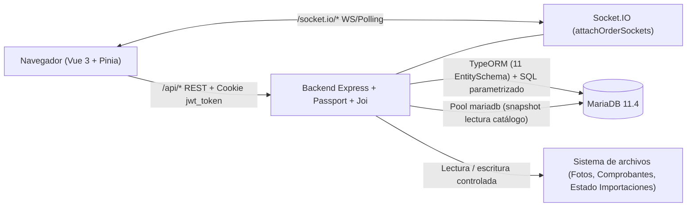

# Ferrepatagonia Industrial

Plataforma web **full stack** orientada a la comercialización mayorista y minorista de productos de ferretería y suministros industriales. Centraliza la consulta del catálogo técnico, la administración diferenciada de clientes particulares y empresas aprobadas, la aplicación de listas de precios, el registro de pedidos en cuenta corriente, la carga masiva de productos y la carga, consulta y revisión documental de comprobantes de pago.

El sistema está destinado a:

- **Visitantes y compradores públicos:** consulta del catálogo, categorías e importes públicos de referencia.
- **Clientes registrados (`PARTICULAR` y `EMPRESA`):** gestión de carrito persistente y, para empresas aprobadas con cuenta corriente habilitada, confirmación de pedidos a crédito, consulta de saldos/movimientos y envío de comprobantes.
- **Administradores (`ADMIN`):** gestión de productos, imágenes, importación masiva CSV/XLSX, categorías, listas de precios, aprobación de clientes empresa, seguimiento de pedidos y revisión de comprobantes.

> **Alcance del proyecto:** se trata de un **proyecto académico de desarrollo full stack** (entrega académica de Programación Backend, corte `develop` posterior al PR #105). No constituye un sistema listo para producción ni reemplaza las validaciones comerciales, de infraestructura TLS/proxy o de pruebas manuales integrales pendientes.

---

## Tabla de contenidos

1. [Funcionalidades implementadas y limitaciones](#funcionalidades-implementadas-y-limitaciones)
2. [Tecnologías utilizadas](#tecnologías-utilizadas)
3. [Arquitectura](#arquitectura)
4. [Requisitos de instalación](#requisitos-de-instalación)
5. [Instalación local paso a paso](#instalación-local-paso-a-paso)
6. [Variables de entorno](#variables-de-entorno)
7. [Programación Backend — Requisitos implementados](#programación-backend--requisitos-implementados)
8. [Pruebas y calidad](#pruebas-y-calidad)
9. [Estructura del repositorio](#estructura-del-repositorio)
10. [Equipo](#equipo)
11. [Documentación adicional](#documentación-adicional)

---

## Funcionalidades implementadas y limitaciones

Las capacidades listadas a continuación corresponden al código efectivo presente en `develop`:

| Módulo | Implementado en código | Limitaciones conocidas |
| --- | --- | --- |
| **Autenticación y autorización** | Registro diferenciado (`PARTICULAR` / `EMPRESA`), login y logout con cookie `HttpOnly` `jwt_token`, endpoint `/api/auth/me` con revalidación contra MariaDB (usuario activo y rol), estrategias Passport JWT, middleware de roles (`CLIENTE`, `ADMIN`), protección de origen/proxy y rate limiting de login/registro. | El rate limiter opera en memoria para un único proceso (`AUTH_RATE_STORE=memory`, `API_PROCESS_COUNT=1`). No incluye CAPTCHA ni recuperación o verificación de contraseña por correo electrónico. |
| **Clientes particulares y empresas** | Alta con validaciones DTO/reglas específicas para particulares y empresas, panel de cuenta (`/mi-cuenta`), alta/edición administrativa de estados y aprobación o rechazo de empresas (`/api/admin/clientes`). | Algunas rutas del menú autenticado siguen declaradas como accesos en preparación sin ruta asignada; ciertas vistas internas priorizan la operación funcional sobre terminaciones visuales completas. |
| **Catálogo y categorías** | Catálogo público paginado (`GET /api/catalogo` y detalle `GET /api/catalogo/:id`), filtros de búsqueda y paginación en frontend, listado público de categorías (`GET /api/categorias`) y administración de categorías (`/api/admin/categorias`). | `GET /api/catalogo` devuelve `precio: null` y `estadoPrecio: "PENDIENTE_DEFINICION"`; los importes efectivos se consultan mediante el módulo de precios. En el menú público, el acceso directo a "Categorías" está marcado en desarrollo, mientras el filtrado por categoría funciona desde `/catalogo`. |
| **Carrito y pedidos** | Carrito autenticado persistido en MariaDB (`/api/carrito`), bloqueo de stock en transacción e historial/detalle de pedidos del cliente (`/api/pedidos`). Confirmación transaccional por cuenta corriente (`/api/pedidos/cuenta-corriente`) con clave de idempotencia UUID v4. | El checkout en línea implementado solo admite pedidos mediante **Cuenta Corriente** para clientes `EMPRESA` aprobados con crédito habilitado y plazo configurado. No existen otros medios de pago online ni checkout directo habilitado para `PARTICULAR`. |
| **Gestión administrativa** | CRUD de productos (`/api/admin/productos`), actualización puntual de stock, carga/reemplazo de imágenes normalizadas, importación masiva CSV/XLSX (`FER16-v2`) con previsualización y confirmación idempotente, categorías, listas de precios, pedidos (`/api/admin/pedidos`) y revisión de comprobantes (`/api/admin/comprobantes`). | El tablero inicial `/admin` (`AdminDashboardView.vue`) conserva tarjetas con valores estáticos de ejemplo en lugar de métricas agregadas en vivo. |
| **Precios y condiciones comerciales** | Cotización pública al 0% (`POST /api/precios`) y privada por lista asignada al cliente (`POST /api/precios/mios`) con soporte USD/ARS, descuentos por volumen y asignación administrativa de listas de precios (`/api/admin/listas-precios`, clientes). | La política comercial definitiva y la habilitación final de listas y monedas permanecen sujetas a validación comercial del cliente. |
| **Cuenta corriente** | Consulta de resumen, límite, saldo USD, movimientos, vencimientos a 30/60 días e imputaciones FIFO (`/api/cuenta-corriente`), más administración de cuentas, plazos, límites y movimientos (`/api/admin/cuentas-corrientes`). Emisión atómica de `CARGO` al confirmar pedidos. | Cuentas legadas sin trazabilidad histórica acreditada informan saldo/disponible en `null`, impidiendo confirmar nuevas compras a crédito hasta su conciliación administrativa. |
| **Archivos y comprobantes** | Subida de planillas CSV/XLSX (`uploadCatalogFile` con Multer), subida y normalización WebP de fotos de producto (`uploadProductImage` con Multer y `sharp`), y carga, consulta y revisión documental de comprobantes de pago (`/api/cuenta-corriente/comprobantes`, `/api/admin/comprobantes`, sin acreditación automática ni modificación de saldos) procesados vía `express.raw` + Worker Threads. | Si faltan `PRODUCT_IMAGE_STORAGE_DIR` o `RECEIPT_STORAGE_DIR`, el servidor arranca, pero esas rutas devuelven HTTP `503`. Para `IMPORT_STORAGE_DIR`, si se omite se usa un directorio temporal del sistema operativo (no persistente ante limpiezas o reinicios), y si se configura una ruta inválida o no escribible responde HTTP `503`. |
| **Actualizaciones en tiempo real** | Servidor Socket.IO autenticado con JWT por cookie y verificación de origen/transporte. Emite `stock.actualizado.v1` a `catalog:authenticated`, y `carrito.actualizado.v1` / `pedido.confirmado.v1` a `orders:client:<id>`. | La sala `orders:admin` se asigna al conectar un `ADMIN`, pero permanece reservada y actualmente **no emite eventos hacia administradores**. |

---

## Tecnologías utilizadas

Versiones verificadas contra [backend/package.json](backend/package.json), [frontend/package.json](frontend/package.json), [compose.yml](compose.yml) y [ci.yml](.github/workflows/ci.yml):

### Frontend

- **Vue 3** (`^3.5.42`)
- **TypeScript** (`~6.0.0`) y `vue-tsc` (`^3.3.11`)
- **Vite** (`^8.2.2`)
- **Pinia** (`^4.0.3`)
- **Vue Router** (`^4.6.4`)
- **Tailwind CSS** (`^4.3.3` vía `@tailwindcss/vite`)
- **Axios** (`^1.20.0`) y **Socket.IO Client** (`^4.8.4`)
- Lectura de planillas en cliente: `read-excel-file` (`^9.3.14`), `fflate` (`^0.8.3`)

### Backend

- **Node.js** (motor declarado `>=22`; referencia probada `22.22.2`)
- **Express** (`^5.1.0`) y **TypeScript** (`~5.9.2`)
- **JWT y autenticación:** `jsonwebtoken` (`^9.0.3`), **Passport** (`0.7.0`), `passport-jwt` (`4.0.1`), `cookie-parser` (`^1.4.7`), `bcrypt` (`^6.0.0`) / `bcryptjs` (`^3.0.3`)
- **Validación de entorno y DTOs:** **Joi** (`^18.3.2`), `class-validator` (`0.14.2`), `class-transformer` (`0.5.1`)
- **Acceso a datos:** **TypeORM** (`0.3.31`), `mysql2` (`3.24.6`), `mariadb` (`^3.4.0`)
- **Archivos e imágenes:** **Multer** (`^2.5.0`), `sharp` (`0.35.5`), `papaparse` (`^5.7.0`), `pdf-lib` (`1.17.1`)
- **Tiempo real y seguridad HTTP:** **Socket.IO** (`^4.8.4`), `express-rate-limit` (`8.7.1`), `dotenv` (`^17.2.0`)

### Base de datos y entorno local

- **MariaDB** (`mariadb:11.4`) ejecutada localmente mediante **Docker Compose** ([compose.yml](compose.yml)). El almacenamiento es manual mediante scripts SQL en [`database/`](database/README.md).

### Pruebas y automatización

- **GitHub Actions** ([.github/workflows/ci.yml](.github/workflows/ci.yml))
- **Node.js Test Runner** (`node --test`) y `tsx` (`^4.20.0`)
- **Playwright** (`@playwright/test` `1.64.1`, pruebas E2E sobre Chromium)

---

## Arquitectura

El sistema sigue una arquitectura cliente-servidor desacoplada:

- **Frontend SPA (`frontend/`):** construido con Vue 3 + Vite + Pinia. En desarrollo, Vite actúa como proxy reverso de `/api` y `/socket.io/` hacia `http://localhost:3000`, manteniendo mismo origen en el navegador.
- **API REST y WebSockets (`backend/`):** un único servidor HTTP Node/Express ([http-server.ts](backend/src/http-server.ts)) expone los endpoints `/api/*` y monta Socket.IO (`attachOrderSockets`).
- **Configuración fail-fast con Joi:** al arrancar ([server.ts](backend/src/server.ts)), `env.config.ts` valida variables críticas y reglas HTTP/proxy antes de inicializar MariaDB o abrir el puerto HTTP.
- **Seguridad basada en cookies:** el inicio de sesión emite la cookie `HttpOnly` `jwt_token`; Passport JWT valida firma, expiración, estado activo y rol vigente en MariaDB. Los middlewares HTTP validan `Origin`/`Referer`/Fetch Metadata y límites de tasa antes de los controladores privados.
- **Persistencia mixta sobre MariaDB:** `ControlledDataSource` (TypeORM con `mysql2`) mapea 11 `EntitySchema` activos y convive con consultas SQL parametrizadas y un pool `mariadb` dedicado para lectura consistente de catálogo (`catalog-snapshot.config.ts`). El esquema SQL ([database/schema.sql](database/schema.sql)) es la fuente autoritativa; `synchronize`, `dropSchema` y `migrationsRun` están deshabilitados.
- **Almacenamiento en disco y tiempo real:** fotos de productos, comprobantes privados y archivos JSON de seguimiento de importaciones CSV/XLSX se guardan en directorios del filesystem definidos por variables de entorno; tras confirmar transacciones críticas en MariaDB, el servidor publica eventos Socket.IO post-commit.



---

## Requisitos de instalación

- **Git**
- **Node.js `22.22.2` + npm `10.9.7`** (versión exacta verificada por el equipo y GitHub Actions).
  - *Nota de compatibilidad:* `backend` declara `"engines": { "node": ">=22" }`, mientras `frontend` declara `"^22.18.0 || >=24.12.0"` por restricciones de dependencias Vite/Playwright. Usar la referencia `22.22.2` para evitar incompatibilidades entre ambos paquetes.
- **Docker** con soporte de contenedores Linux y **Docker Compose** v2 (`docker compose version`). En Linux, el usuario debe tener permisos sobre el daemon Docker.

---

## Instalación local paso a paso

> **Importante sobre Docker Compose:** [`compose.yml`](compose.yml) **únicamente** levanta el contenedor de **MariaDB 11.4** en `127.0.0.1:3307`. **No** levanta automáticamente el backend ni el frontend, y **no** ejecuta automáticamente los scripts de esquema ni de datos de prueba (`database/` se monta solo lectura en `/scripts`).

1. **Clonar el repositorio:**

   ```bash
   git clone https://github.com/Sannlehnert/ferrepatagonia-industrial.git
   cd ferrepatagonia-industrial
   ```

2. **Instalar dependencias de backend y frontend:**

   ```bash
   cd backend && npm ci && cd ..
   cd frontend && npm ci && cd ..
   ```

3. **Levantar MariaDB con Docker Compose (desde la raíz):**

   ```bash
   docker compose up -d --wait --wait-timeout 180 mariadb
   ```

4. **Crear `backend/.env` desde la plantilla de desarrollo:**

   - En **Bash (Linux/macOS):**

     ```bash
     cp backend/.env.example backend/.env
     ```

   - En **PowerShell (Windows):**

     ```powershell
     Copy-Item backend\.env.example backend\.env
     ```

5. **Generar un `JWT_SECRET` local y colocarlo en `backend/.env`:**

   ```bash
   node -e "console.log(require('node:crypto').randomBytes(32).toString('hex'))"
   ```

   Pegar el resultado en `JWT_SECRET=<valor-generado>` dentro de `backend/.env` (nunca dejar vacío ni versionar `.env`).

6. **Inicializar esquema y datos de prueba (solo sobre una base nueva/vacía):**

   > No ejecutar estos scripts sobre una base persistente que ya contenga tablas o datos. Para detalle operativo y reset controlado, consultar [database/README.md](database/README.md).

   ```bash
   docker compose exec -T mariadb sh -c 'mariadb --default-character-set=utf8mb4 -uferrepatagonia -pferrepatagonia_dev_only ferrepatagonia_dev < /scripts/schema.sql'
   docker compose exec -T mariadb sh -c 'mariadb --default-character-set=utf8mb4 -uferrepatagonia -pferrepatagonia_dev_only ferrepatagonia_dev < /scripts/seed.sql'
   docker compose exec -T mariadb sh -c 'mariadb --default-character-set=utf8mb4 -uferrepatagonia -pferrepatagonia_dev_only ferrepatagonia_dev < /scripts/verify-seed.sql'
   ```

   La verificación final debe mostrar `PASS: conteos, relaciones, importes y destinos de pago`.

7. **Arrancar el backend (en una terminal desde `backend/`):**

   ```bash
   cd backend
   npm run dev
   ```

   Escucha por defecto en `http://localhost:3000`.

8. **Arrancar el frontend (en otra terminal desde `frontend/`):**

   ```bash
   cd frontend
   npm run dev
   ```

   Escucha por defecto en `http://localhost:5173`.

9. **Verificar el API y abrir la aplicación web:**

   - Consultar salud del backend:

     ```bash
     curl -i http://localhost:3000/api/health
     ```

     Respuesta esperada: HTTP `200` con `{"api":"ok","database":"ok"}`.

   - Abrir en el navegador `http://localhost:5173`.

---

## Variables de entorno

La plantilla local de referencia es [backend/.env.example](backend/.env.example) y su documentación completa se encuentra en [backend/README.md](backend/README.md#configuración). Todas las variables se validan al iniciar con **Joi** (`{ convert: false }`).

| Categoría | Variables | Descripción y comportamiento |
| --- | --- | --- |
| **Base de datos** | `DB_HOST`, `DB_PORT`, `DB_NAME`, `DB_USER`, `DB_PASSWORD`, `LEGACY_ORDER_UTC_OFFSET` | Parámetros de conexión a MariaDB (el Compose local expone `127.0.0.1:3307` y base `ferrepatagonia_dev`). `DB_HOST`, `DB_NAME`, `DB_USER` y `DB_PASSWORD` son obligatorias. |
| **Autenticación JWT** | `JWT_SECRET` | Obligatoria al iniciar. Secreto para firmar/verificar JWT `HS256`. Sin fallback interno; en producción exige secreto privado de al menos 32 bytes sin repetición trivial. |
| **Entorno HTTP y origen** | `NODE_ENV`, `PORT`, `APP_PUBLIC_ORIGIN` | `NODE_ENV` (`development`, `test`, `production`) es obligatorio. `APP_PUBLIC_ORIGIN` define el origen exacto permitido (`http://localhost:5173` en dev; HTTPS obligatorio en `production`). |
| **Proxy y rate limit** | `TRUSTED_PROXY_CIDRS`, `HTTPS_TERMINATION`, `AUTH_RATE_STORE`, `API_PROCESS_COUNT`, `AUTH_LOGIN_LIMIT`, `AUTH_LOGIN_WINDOW_MS`, `AUTH_REGISTER_LIMIT`, `AUTH_REGISTER_WINDOW_MS` | Regulan confianza en proxies, requerimiento de HTTPS (`trusted-proxy` obligatorio en producción) y cuotas en memoria (`memory`, 1 proceso). |
| **Almacenamiento** | `PRODUCT_IMAGE_STORAGE_DIR`, `RECEIPT_STORAGE_DIR`, `IMPORT_STORAGE_DIR` | Rutas absolutas opcionales al arrancar (Joi rechaza valores relativos o malformados). |

### Diferencia entre variables de almacenamiento opcionales al arrancar vs requeridas al operar

- **`PRODUCT_IMAGE_STORAGE_DIR` y `RECEIPT_STORAGE_DIR`:** pueden omitirse al iniciar el servidor (por ejemplo, para levantar salud/catálogo básico), pero si se intenta cargar o consultar fotos de productos o comprobantes sin una ruta absoluta válida, existente y aislada del repositorio, los endpoints responden HTTP **`503`**.
- **`IMPORT_STORAGE_DIR`:** si se omite o queda vacía (`""`), el backend utiliza el subdirectorio temporal controlado `ferrepatagonia-import-storage` dentro del directorio temporal del sistema operativo (apto solo para desarrollo y pruebas; su contenido **no es persistente** ante reinicios ni limpiezas del sistema). Si se configura explícitamente un valor, debe ser una ruta absoluta existente y escribible; ante una ruta inválida, inexistente, sin permisos o falla de escritura en disco, el sistema **no realiza fallback silencioso** y devuelve un error controlado HTTP **`503`** sin confirmar registros no persistidos.

---

## Programación Backend — Requisitos implementados

Sección de verificación técnica para la evaluación académica de Backend:

| Requisito | Tecnología | Estado | Archivos principales |
| --- | --- | --- | --- |
| **1. Login y autorización** (obligatorio) | JWT (`jsonwebtoken`) + Passport (`passport-jwt`) + `bcrypt` | Implementado | [auth.routes.ts](backend/src/routes/auth.routes.ts), [auth.controller.ts](backend/src/controllers/auth.controller.ts), [token.service.ts](backend/src/services/token.service.ts), [passport.config.ts](backend/src/config/passport.config.ts), [auth.middleware.ts](backend/src/middlewares/auth.middleware.ts), [auth-cookie.config.ts](backend/src/config/auth-cookie.config.ts) |
| **2. Validación de entorno** (obligatorio) | Joi | Implementado | [env.config.ts](backend/src/config/env.config.ts), [http-security.config.ts](backend/src/config/http-security.config.ts), [storage-env.config.ts](backend/src/config/storage-env.config.ts), [server.ts](backend/src/server.ts) |
| **3. ORM para base de datos** (obligatorio) | TypeORM (`mysql2`) | Implementado (convive con SQL directo y adaptador `mariadb`) | [database.config.ts](backend/src/config/database.config.ts), [active.schemas.ts](backend/src/entities/active.schemas.ts), [catalog-snapshot.config.ts](backend/src/config/catalog-snapshot.config.ts), [usuario.repository.ts](backend/src/repositories/usuario.repository.ts), [cart.repository.ts](backend/src/repositories/cart.repository.ts) |
| **4. Carga de archivos** (opcional) | Multer | Implementado (planillas e imágenes) | [fileUpload.middleware.ts](backend/src/middlewares/fileUpload.middleware.ts), [productImageUpload.middleware.ts](backend/src/middlewares/productImageUpload.middleware.ts), [productImport.routes.ts](backend/src/routes/productImport.routes.ts), [adminProduct.routes.ts](backend/src/routes/adminProduct.routes.ts), [productImage.service.ts](backend/src/services/productImage.service.ts) |
| **5. Tiempo real** (opcional) | Socket.IO | Implementado (eventos cliente y catálogo) | [http-server.ts](backend/src/http-server.ts), [order-sockets.ts](backend/src/realtime/order-sockets.ts), [committed-change.ts](backend/src/realtime/committed-change.ts), [socket-transport.ts](backend/src/realtime/socket-transport.ts) |

### Detalle y cómo verificar cada punto

1. **JWT + Passport:** `POST /api/auth/login` verifica contraseña con `bcrypt`, emite un JWT `HS256` (expiración `2h`) exclusivamente en cookie `HttpOnly` (`jwt_token`) y las rutas privadas usan `authenticate` / `authorizeRoles` revalidando usuario activo y rol en MariaDB.
   - *Verificación:* revisar `test/auth.passport.test.cjs`, `test/auth.middleware.test.cjs`, `test/auth.me.test.cjs` mediante `npm --prefix backend run test:unit`, o probar `POST /api/auth/login`, `GET /api/auth/me` y `POST /api/auth/logout`.
2. **Joi:** `loadEnv` valida de manera estricta (`convert: false`) configuración de BD, `JWT_SECRET`, seguridad HTTP/proxy, rate limits y rutas opcionales de almacenamiento al importar la configuración antes de abrir conexiones.
   - *Verificación:* `node --require ./test/helpers/test-env.cjs --test test/env-config.test.cjs` desde `backend/`, que incluye ensayos reales de arranque fallido de `dist/server.js` sin filtrar secretos.
3. **TypeORM:** `ControlledDataSource` registra **11 `EntitySchema` activos** en `activeSchemas` (`CategoriaSchema`, `ProductoSchema`, `ClienteSchema`, `UsuarioSchema`, `ListaPrecioSchema`, `CotizacionSchema`, `CarritoSchema`, `ItemCarritoSchema`, `CuentaCorrienteSchema`, `MovimientoCuentaCorrienteSchema`, `ImputacionMovimientoCuentaCorrienteSchema`).
   - *Aclaración técnica:* no todas las tablas de `database/schema.sql` (21 tablas) están mapeadas con `EntitySchema`. El uso de TypeORM (`getRepository`, `QueryBuilder`, `QueryRunner` / transacciones) convive con consultas SQL parametrizadas mediante `EntityManager.query` (por ejemplo bloqueos `FOR UPDATE`) y con el pool `mariadb` dedicado al snapshot de lectura consistente del catálogo (`catalog-snapshot.config.ts`). `synchronize`, `dropSchema` y `migrationsRun` permanecen en `false`.
   - *Verificación:* `npm --prefix backend run test:unit` (`test/database.test.cjs`, `test/database-outcome.test.cjs`) y `npm --prefix backend run test:integration`.
4. **Multer:** utilizado con `memoryStorage` y límite de `5 MiB` en dos flujos: importación masiva de catálogo CSV/XLSX (`uploadCatalogFile`, validación de extensión/MIME/cabeceras binarias) y carga/reemplazo de fotos de productos (`uploadProductImage` + normalización WebP con `sharp`). *(La carga de comprobantes de pago usa `express.raw` + Worker Threads en [paymentReceipt.routes.ts](backend/src/routes/paymentReceipt.routes.ts), no Multer.)*
   - *Verificación:* `node --require ./test/helpers/test-env.cjs --test test/productImport.test.cjs` y `npm --prefix backend run test:integration` (`test/helpers/run-admin-products-mariadb.cjs`).
5. **Socket.IO:** adjunto al servidor HTTP en `createBackendServer` con autenticación JWT por cookie y verificación de origen. Emite notificaciones post-commit `stock.actualizado.v1` a `catalog:authenticated` (clientes y administradores autenticados) y `carrito.actualizado.v1` / `pedido.confirmado.v1` a `orders:client:<id>`.
   - *Aclaración técnica:* aunque los usuarios `ADMIN` se unen a `orders:admin`, dicha sala permanece reservada y actualmente **no emite eventos hacia administradores**.
   - *Verificación:* `node --require ./test/helpers/test-env.cjs --test test/order-sockets.test.cjs` y `npm --prefix backend run test:orders:sockets` (con Docker).

---

## Pruebas y calidad

Los scripts disponibles están definidos en [backend/package.json](backend/package.json), [frontend/package.json](frontend/package.json) y [ci.yml](.github/workflows/ci.yml):

| Alcance | Comando | Requisitos / Observaciones |
| --- | --- | --- |
| **Type-check backend** | `npm --prefix backend run type-check` | Ejecuta `tsc --noEmit`. |
| **Build backend** | `npm --prefix backend run build` | Compila TypeScript en `backend/dist/`. |
| **Pruebas unitarias backend** | `npm --prefix backend run test:unit` | Incluye pruebas de autenticación, Joi, DTOs, importación, precios, cuentas y sockets sin DB real. |
| **Verificación fuentes DTO** | `npm --prefix backend run test:dto-source` | Valida contratos estáticos de DTOs y Passport. |
| **Pruebas integración backend** | `npm --prefix backend run test:integration` | **Requiere Docker.** Levanta contenedores e instancias MariaDB desechables por suite y los elimina al finalizar. |
| **Suite completa backend** | `npm --prefix backend test` | Ejecuta build + `test:unit` + `test:dto-source` + `test:integration`. |
| **Type-check frontend** | `npm --prefix frontend run type-check` | Ejecuta `vue-tsc --build`. |
| **Build frontend** | `npm --prefix frontend run build` | Ejecuta `vue-tsc --build` y `vite build` en paralelo. |
| **Pruebas unitarias frontend** | `npm --prefix frontend test` | Ejecuta `node --test` en `frontend/test/`. |
| **E2E Playwright** | `node backend/test/helpers/run-e2e.cjs` | **Requiere Docker**, builds previos (`backend` y `frontend`) y Chromium de Playwright. Usa base descartable aislada; soporta perfiles `--fer19`, `--fer19-production`, `--receipts`. |
| **CI en GitHub Actions** | Ver [ci.yml](.github/workflows/ci.yml) | Ejecuta `npm ci`, `npm audit --audit-level=high`, type-check, build, pruebas unitarias, integración MariaDB aislada y E2E en cada push/PR hacia `develop` o `main`. |

---

## Estructura del repositorio

```text
ferrepatagonia-industrial/
├── backend/       # API REST Express, Socket.IO, TypeORM, Joi, Multer, pruebas unitarias y helpers Docker
├── frontend/      # SPA Vue 3 + TypeScript + Vite + Pinia + Tailwind CSS, pruebas unitarias y E2E Playwright
├── database/      # Esquema SQL autoritativo (schema.sql), seed de desarrollo, migraciones y verificación
├── docs/          # Guías técnicas, contratos REST/Socket.IO, MER, decisiones de arquitectura y evidencia
├── data/          # Catálogo demo de apoyo y utilidades locales de carga
├── .github/       # Workflow de CI/CD en GitHub Actions
└── compose.yml    # Definición Docker Compose exclusiva para MariaDB 11.4 local
```

---

## Equipo

Proyecto desarrollado por el equipo **WebFaster**:

- **Santiago Agustín Lehnert**
- **Lucciano Perticarini**
- **Zahir Timm**
- **Bruno Vagnola**

---

## Documentación adicional

- **Backend (contratos auth, seguridad HTTP, endpoints y matriz académica):** [backend/README.md](backend/README.md)
- **Base de datos (Docker Compose, scripts SQL, migración SKU y pruebas):** [database/README.md](database/README.md)
- **Índice general de documentación y guías canónicas:** [docs/README.md](docs/README.md)
- **Arquitectura general del sistema:** [docs/arquitectura/arquitectura-general.md](docs/arquitectura/arquitectura-general.md)
- **Contratos de API y tiempo real:**
  - Catálogo y categorías: [docs/api/catalogo.md](docs/api/catalogo.md), [docs/api/categorias.md](docs/api/categorias.md)
  - Productos e importación admin: [docs/api/admin-productos.md](docs/api/admin-productos.md), [docs/decisiones/fer-16-politica-importacion-filas-invalidas.md](docs/decisiones/fer-16-politica-importacion-filas-invalidas.md)
  - Carrito, precios, cuenta corriente y comprobantes: [docs/api/carrito.md](docs/api/carrito.md), [docs/api/precios.md](docs/api/precios.md), [docs/contratos/fer-19-cuenta-corriente.md](docs/contratos/fer-19-cuenta-corriente.md), [docs/275-payment-receipts.md](docs/275-payment-receipts.md)
  - Eventos Socket.IO: [docs/281/README.md](docs/281/README.md), [docs/281/socket-events.md](docs/281/socket-events.md)
- **Operación y preparación de release:** [docs/operaciones-release.md](docs/operaciones-release.md)
- **Modelo entidad-relación:** [docs/modelo-datos/mer-ferrepatagonia.md](docs/modelo-datos/mer-ferrepatagonia.md)
