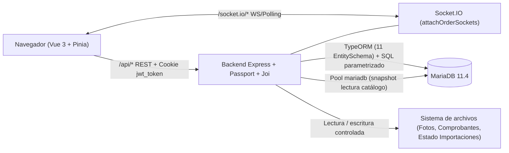

# Ferrepatagonia Industrial

Plataforma web **full stack** orientada a la comercialización mayorista y minorista de productos de ferretería y suministros industriales. Centraliza la consulta del catálogo técnico, la administración diferenciada de clientes particulares y empresas aprobadas, la aplicación de listas de precios, el registro de pedidos en cuenta corriente, la carga masiva de productos y la carga, consulta y revisión documental de comprobantes de pago.

El sistema está destinado a:

- **Visitantes y compradores públicos:** consulta del catálogo, categorías e importes públicos de referencia.
- **Clientes registrados (`PARTICULAR` y `EMPRESA`):** gestión de carrito persistente y, para empresas aprobadas con cuenta corriente habilitada, confirmación de pedidos a crédito, consulta de saldos/movimientos y envío de comprobantes.
- **Administradores (`ADMIN`):** gestión de productos, imágenes, importación masiva CSV/XLSX, categorías, listas de precios, aprobación de clientes empresa, seguimiento de pedidos y revisión de comprobantes.

> **Alcance del proyecto:** se trata de un **proyecto académico de desarrollo full stack** desarrollado para la asignatura **Práctica Profesionalizante** (estado vigente sobre `develop`). No constituye un sistema listo para producción ni reemplaza las validaciones comerciales, de infraestructura TLS/proxy o de pruebas manuales integrales pendientes.

---

## Tabla de contenidos

1. [Funcionalidades implementadas y limitaciones](#funcionalidades-implementadas-y-limitaciones)
2. [Tecnologías utilizadas](#tecnologías-utilizadas)
3. [Arquitectura](#arquitectura)
4. [Requisitos de instalación](#requisitos-de-instalación)
5. [Instalación local paso a paso](#instalación-local-paso-a-paso)
6. [Catálogo normal de 100 productos](#catálogo-normal-de-100-productos)
7. [Variables de entorno](#variables-de-entorno)
8. [Práctica Profesionalizante — Requisitos técnicos implementados](#práctica-profesionalizante--requisitos-técnicos-implementados)
9. [Pruebas y calidad](#pruebas-y-calidad)
10. [Estructura del repositorio](#estructura-del-repositorio)
11. [Equipo](#equipo)
12. [Documentación adicional](#documentación-adicional)

---

## Funcionalidades implementadas y limitaciones

Las capacidades listadas a continuación corresponden al código efectivo presente en `develop`:

| Módulo | Implementado en código | Limitaciones conocidas |
| --- | --- | --- |
| **Autenticación y autorización** | Registro diferenciado (`PARTICULAR` / `EMPRESA`), login y logout con cookie `HttpOnly` `jwt_token`, endpoint `/api/auth/me` con revalidación contra MariaDB (usuario activo y rol), estrategias Passport JWT, middleware de roles (`CLIENTE`, `ADMIN`), protección de origen/proxy y rate limiting de login/registro. | El rate limiter opera en memoria para un único proceso (`AUTH_RATE_STORE=memory`, `API_PROCESS_COUNT=1`). No incluye CAPTCHA ni recuperación o verificación de contraseña por correo electrónico. |
| **Clientes particulares y empresas** | Alta con validaciones DTO/reglas específicas para particulares y empresas, panel de cuenta (`/mi-cuenta`), alta/edición administrativa de estados y aprobación o rechazo de empresas (`/api/admin/clientes`). | Algunas rutas del menú autenticado siguen declaradas como accesos en preparación sin ruta asignada; ciertas vistas internas priorizan la operación funcional sobre terminaciones visuales completas. |
| **Catálogo y categorías** | Catálogo público paginado (`GET /api/catalogo` y detalle `GET /api/catalogo/:id`), filtros de búsqueda y paginación en frontend, listado público de categorías (`GET /api/categorias`) y administración de categorías (`/api/admin/categorias`). | `GET /api/catalogo` devuelve `precio: null` y `estadoPrecio: "PENDIENTE_DEFINICION"`; los importes efectivos se consultan mediante el módulo de precios. En el menú público, el acceso directo a "Categorías" está marcado en desarrollo, mientras el filtrado por categoría funciona desde `/catalogo`. |
| **Carrito y pedidos** | Carrito autenticado persistido en MariaDB (`/api/carrito`), bloqueo de stock en transacción e historial/detalle de pedidos del cliente (`/api/pedidos`). Confirmación transaccional por cuenta corriente (`/api/pedidos/cuenta-corriente`) con clave de idempotencia UUID v4. | El checkout en línea implementado solo admite pedidos mediante **Cuenta Corriente** para clientes `EMPRESA` aprobados con crédito habilitado y plazo configurado. No existen otros medios de pago online ni checkout directo habilitado para `PARTICULAR`. |
| **Gestión administrativa** | CRUD de productos (`/api/admin/productos`), actualización puntual de stock, carga/reemplazo de imágenes normalizadas, importación masiva CSV/XLSX (`FER16-v2`) con previsualización y confirmación idempotente, categorías, listas de precios, pedidos (`/api/admin/pedidos`), revisión de comprobantes (`/api/admin/comprobantes`) y revisión/acreditación de declaraciones de pago (`/api/admin/pagos`). | El tablero inicial `/admin` (`AdminDashboardView.vue`) conserva tarjetas con valores estáticos de ejemplo en lugar de métricas agregadas en vivo. |
| **Precios y condiciones comerciales** | Cotización pública al 0% (`POST /api/precios`) y privada por lista asignada al cliente (`POST /api/precios/mios`) con soporte USD/ARS, descuentos por volumen y asignación administrativa de listas de precios (`/api/admin/listas-precios`, clientes). | La política comercial definitiva y la habilitación final de listas y monedas permanecen sujetas a validación comercial del cliente. |
| **Cuenta corriente** | Consulta propia de resumen, límite, saldo USD, movimientos, vencimientos a 30/60 días e imputaciones FIFO (`/api/cuenta-corriente`), declaración de pagos con comprobante e idempotencia (`/api/cuenta-corriente/pagos`), y consulta administrativa del listado de cuentas corrientes (`/api/admin/cuentas-corrientes`), resumen de una cuenta (`/api/admin/clientes/:clienteId/cuenta-corriente`), movimientos (`/api/admin/clientes/:clienteId/cuenta-corriente/movimientos`) y vencimientos (`/api/admin/clientes/:clienteId/cuenta-corriente/vencimientos`). Revisión documental y acreditación financiera separadas en `/api/admin/pagos`. Emisión atómica de `CARGO` al confirmar pedidos. | Los endpoints administrativos de cuenta corriente implementados en `backend/src/routes/admin.routes.ts` son de consulta (`GET`) salvo la revisión y acreditación de pagos. No exponen modificación de cuentas, plazos, límites ni movimientos. Además, cuentas legadas sin trazabilidad histórica acreditada informan saldo/disponible en `null`, impidiendo confirmar nuevas compras a crédito hasta su conciliación administrativa. |
| **Archivos y comprobantes** | Subida de planillas CSV/XLSX (`uploadCatalogFile` con Multer), subida y normalización WebP de fotos de producto (`uploadProductImage` con Multer y `sharp`), y carga, consulta y revisión documental de comprobantes de pago (`/api/cuenta-corriente/comprobantes`, `/api/admin/comprobantes`, sin acreditación automática ni modificación de saldos) procesados vía `express.raw` + Worker Threads. | Si faltan `PRODUCT_IMAGE_STORAGE_DIR` o `RECEIPT_STORAGE_DIR`, el servidor arranca, pero esas rutas devuelven HTTP `503`. Para `IMPORT_STORAGE_DIR`, si se omite se usa un directorio temporal del sistema operativo (no persistente ante limpiezas o reinicios), y si se configura una ruta inválida o no escribible responde HTTP `503`. |
| **Actualizaciones en tiempo real** | Servidor Socket.IO autenticado con JWT por cookie y verificación de origen/transporte. Emite `stock.actualizado.v1` a `catalog:authenticated`, y `carrito.actualizado.v1` / `pedido.confirmado.v1` a `orders:client:<id>`. | La sala `orders:admin` se asigna al conectar un `ADMIN`, pero permanece reservada y actualmente **no emite eventos hacia administradores**. |

---

## Tecnologías utilizadas

Versiones verificadas contra [backend/package.json](backend/package.json), [frontend/package.json](frontend/package.json), [compose.yml](compose.yml) y [ci.yml](.github/workflows/ci.yml):

### Frontend

- **Vue 3** (`^3.5.42`)
- **TypeScript** (`~6.0.0`) y `vue-tsc` (`^3.3.11`)
- **Vite** (`^8.2.2`)
- **Pinia** (`^4.0.3`)
- **Vue Router** (`^4.6.4`)
- **Tailwind CSS** (`^4.3.3` vía `@tailwindcss/vite`)
- **Axios** (`^1.20.0`) y **Socket.IO Client** (`^4.8.4`)
- Lectura de planillas en cliente: `read-excel-file` (`^9.3.14`), `fflate` (`^0.8.3`)

### Backend

- **Node.js** (motor declarado `>=22`; referencia probada `22.22.2`)
- **Express** (`^5.1.0`) y **TypeScript** (`~5.9.2`)
- **JWT y autenticación:** `jsonwebtoken` (`^9.0.3`), **Passport** (`0.7.0`), `passport-jwt` (`4.0.1`), `cookie-parser` (`^1.4.7`), `bcrypt` (`^6.0.0`) / `bcryptjs` (`^3.0.3`)
- **Validación de entorno y DTOs:** **Joi** (`^18.3.2`), `class-validator` (`0.14.2`), `class-transformer` (`0.5.1`)
- **Acceso a datos:** **TypeORM** (`0.3.31`), `mysql2` (`3.24.6`), `mariadb` (`^3.4.0`)
- **Archivos e imágenes:** **Multer** (`^2.5.0`), `sharp` (`0.35.5`), `papaparse` (`^5.7.0`), `pdf-lib` (`1.17.1`)
- **Tiempo real y seguridad HTTP:** **Socket.IO** (`^4.8.4`), `express-rate-limit` (`8.7.1`), `dotenv` (`^17.2.0`)

### Base de datos y entorno local

- **MariaDB** (`mariadb:11.4`) ejecutada localmente mediante **Docker Compose** ([compose.yml](compose.yml)). El almacenamiento es manual mediante scripts SQL en [`database/`](database/README.md).

### Pruebas y automatización

- **GitHub Actions** ([.github/workflows/ci.yml](.github/workflows/ci.yml))
- **Node.js Test Runner** (`node --test`) y `tsx` (`^4.20.0`)
- **Playwright** (`@playwright/test` `1.64.1`, pruebas E2E sobre Chromium)

---

## Arquitectura

El sistema sigue una arquitectura cliente-servidor desacoplada:

- **Frontend SPA (`frontend/`):** construido con Vue 3 + Vite + Pinia. En desarrollo, Vite actúa como proxy reverso de `/api` y `/socket.io/` hacia `http://localhost:3000`, manteniendo mismo origen en el navegador.
- **API REST y WebSockets (`backend/`):** un único servidor HTTP Node/Express ([http-server.ts](backend/src/http-server.ts)) expone los endpoints `/api/*` y monta Socket.IO (`attachOrderSockets`).
- **Configuración fail-fast con Joi:** al arrancar ([server.ts](backend/src/server.ts)), `env.config.ts` valida variables críticas y reglas HTTP/proxy antes de inicializar MariaDB o abrir el puerto HTTP.
- **Seguridad basada en cookies:** el inicio de sesión emite la cookie `HttpOnly` `jwt_token`; Passport JWT valida firma, expiración, estado activo y rol vigente en MariaDB. Los middlewares HTTP validan `Origin`/`Referer`/Fetch Metadata y límites de tasa antes de los controladores privados.
- **Persistencia mixta sobre MariaDB:** `ControlledDataSource` (TypeORM con `mysql2`) mapea 11 `EntitySchema` activos y convive con consultas SQL parametrizadas, un pool `mariadb` dedicado para lectura consistente de catálogo (`catalog-snapshot.config.ts`) y un pool específico de privilegios mínimos para verificación de precios (`price-verification.config.ts`). El esquema SQL ([database/schema.sql](database/schema.sql) junto con las 6 migraciones documentadas en [database/README.md](database/README.md)) es la fuente autoritativa; `synchronize`, `dropSchema` y `migrationsRun` están deshabilitados.
- **Almacenamiento en disco y tiempo real:** fotos de productos, comprobantes privados y archivos JSON de seguimiento de importaciones CSV/XLSX se guardan en directorios del filesystem definidos por variables de entorno; tras confirmar transacciones críticas en MariaDB, el servidor publica eventos Socket.IO post-commit.



---

## Requisitos de instalación

- **Git**
- **Node.js `22.22.2` + npm `10.9.7`** (versión exacta verificada por el equipo y GitHub Actions).
  - *Nota de compatibilidad:* `backend` declara `"engines": { "node": ">=22" }`, mientras `frontend` declara `"^22.18.0 || >=24.12.0"` por restricciones de dependencias Vite/Playwright. Usar la referencia `22.22.2` para evitar incompatibilidades entre ambos paquetes.
- **Docker** con soporte de contenedores Linux y **Docker Compose** v2 (`docker compose version`). En Linux, el usuario debe tener permisos sobre el daemon Docker.

---

## Instalación local paso a paso

Esta es la instalación normal recomendada. Parte de una base **vacía** y termina
con las **ocho categorías**, los **100 SKU** del catálogo maestro, sus imágenes y
las referencias de precio publicadas por un ADMIN autorizado. **No** carga
`seed.sql` ni la demo de 904 productos: esos fixtures son incompatibles con el
importador del catálogo maestro.

> **Docker Compose:** [`compose.yml`](compose.yml) solo levanta **MariaDB 11.4**
> en `127.0.0.1:3307`. No inicia backend, frontend ni ejecuta scripts SQL.
> `database/` se monta como `/scripts` de solo lectura.

> **Segunda instalación simultánea en el mismo equipo:** usar un checkout
> separado, un nombre de proyecto Compose y un puerto libres. Por ejemplo,
> establecer `COMPOSE_PROJECT_NAME=ferrepatagonia-otra`, cambiar **solo en la
> copia** el puerto de `127.0.0.1:3307:3306` a `127.0.0.1:3318:3306`, y usar
> `DB_PORT=3318` en el `.env` de esa copia. Mantener esos valores durante todo
> el procedimiento, incluido el reinicio, y usar directorios de archivos propios.

### 1. Requisitos previos

- **Git**.
- **Node.js `22.22.2` + npm `10.9.7`** (versión exacta usada por el equipo y por
  GitHub Actions). Comprobar con `node --version` y `npm --version`.
  - `backend` declara `"engines": { "node": ">=22" }`; `frontend` declara
    `^22.18.0 || >=24.12.0` por sus dependencias de Vite/Playwright. La
    referencia `22.22.2` evita incompatibilidades entre ambos paquetes.
- **Docker** con contenedores Linux y **Docker Compose v2**. En Linux, el
  usuario debe poder ejecutar Docker.
- **MariaDB 11.4** se obtiene desde la imagen de `compose.yml`; no hace falta
  instalar MariaDB en el host.
- Puertos libres en loopback: `3307` (MariaDB), `3000` (API) y `5173` (web en
  desarrollo). Para una segunda instalación, elegir otros.

### 2. Clonar el repositorio e instalar dependencias

```bash
git clone https://github.com/Sannlehnert/ferrepatagonia-industrial.git
cd ferrepatagonia-industrial
git switch develop
git pull --ff-only origin develop
npm ci --prefix backend
npm ci --prefix frontend
```

`npm ci` instala exactamente `package-lock.json`; no sustituirlo por `npm install`
para la validación de release.

### 3. Configurar `backend/.env`

```bash
cp backend/.env.example backend/.env
node -e "console.log(require('node:crypto').randomBytes(32).toString('hex'))"
```

Editar `backend/.env`:

- pegar el valor generado en `JWT_SECRET` (nunca vacío ni versionado);
- mantener `DB_HOST=127.0.0.1`, `DB_PORT=3307`, `DB_NAME=ferrepatagonia_dev`,
  `DB_USER=ferrepatagonia` y `DB_PASSWORD=ferrepatagonia_dev_only` para el
  Compose local;
- usar `NODE_ENV=development` y `APP_PUBLIC_ORIGIN=http://127.0.0.1:5173`.
  Para una segunda instalación, ajustar `DB_PORT` y el origen.

No copiar `backend/.env` a un repositorio ni reutilizar estos valores fuera de
desarrollo local.

### 4. Crear los directorios persistentes

Las fotos, los comprobantes privados y el estado de importaciones deben vivir
**fuera del checkout**, en tres directorios separados y sin relaciones de
contención. Agregar a `backend/.env` rutas absolutas, por ejemplo:

```dotenv
PRODUCT_IMAGE_STORAGE_DIR=/home/<usuario>/ferrepatagonia-datos/fotos-productos
RECEIPT_STORAGE_DIR=/home/<usuario>/ferrepatagonia-datos/comprobantes
IMPORT_STORAGE_DIR=/home/<usuario>/ferrepatagonia-datos/importaciones
```

Validar y crear con el mecanismo existente:

```bash
cd backend
node scripts/prepare-local-storage.cjs
node scripts/prepare-local-storage.cjs --apply
cd ..
```

En Windows usar rutas como `C:\Datos\ferrepatagonia\...`. El script crea con
permisos restrictivos, rechaza symlinks y no relaja permisos preexistentes.
Mantener estos directorios y el volumen de MariaDB en la estrategia de respaldo.

### 5. Iniciar MariaDB

```bash
docker compose config
docker compose up -d --wait --wait-timeout 180 mariadb
docker compose ps
```

Esperar `healthy`. Si falla, revisar `docker compose logs --tail=100 mariadb`
antes de continuar.

### 6. Crear el esquema y aplicar las seis migraciones

Ejecutar **una sola vez** sobre una base vacía, en este orden. Si un comando
falla, detenerse y revisar el error; no continuar ni repetir `schema.sql`.

```bash
docker compose exec -T mariadb sh -c 'mariadb --default-character-set=utf8mb4 -uferrepatagonia -pferrepatagonia_dev_only ferrepatagonia_dev < /scripts/schema.sql'
docker compose exec -T mariadb sh -c 'mariadb --default-character-set=utf8mb4 -uferrepatagonia -pferrepatagonia_dev_only ferrepatagonia_dev < /scripts/migrate-fer-20-account-movements.sql'
docker compose exec -T mariadb sh -c 'mariadb --default-character-set=utf8mb4 -uferrepatagonia -pferrepatagonia_dev_only ferrepatagonia_dev < /scripts/migrate-fer-17-price-verification.sql'
docker compose exec -T mariadb sh -c 'mariadb --default-character-set=utf8mb4 -uferrepatagonia -pferrepatagonia_dev_only ferrepatagonia_dev < /scripts/migrate-s7-09-1-credit-workflow.sql'
docker compose exec -T mariadb sh -c 'mariadb --default-character-set=utf8mb4 -uferrepatagonia -pferrepatagonia_dev_only ferrepatagonia_dev < /scripts/migrate-s7-06-1-transfer-order-confirmation.sql'
docker compose exec -T mariadb sh -c 'mariadb --default-character-set=utf8mb4 -uferrepatagonia -pferrepatagonia_dev_only ferrepatagonia_dev < /scripts/migrate-s7-04-2-state-consistency.sql'
docker compose exec -T mariadb sh -c 'mariadb --default-character-set=utf8mb4 -uferrepatagonia -pferrepatagonia_dev_only ferrepatagonia_dev < /scripts/migrate-s7-10-2-payment-accreditation.sql'
```

`schema.sql` crea las **26 tablas** base. Las migraciones agregan las tablas de
crédito, la auditoría FER-17, los **13 triggers** y la vista
`FER17_AUDITORIA_TRIGGERS`. Verificar explícitamente:

```bash
docker compose exec -T mariadb mariadb --default-character-set=utf8mb4 -uferrepatagonia -pferrepatagonia_dev_only ferrepatagonia_dev -e "SELECT COUNT(*) AS tablas FROM information_schema.TABLES WHERE TABLE_SCHEMA = DATABASE() AND TABLE_TYPE = 'BASE TABLE'; SELECT COUNT(*) AS triggers FROM information_schema.TRIGGERS WHERE TRIGGER_SCHEMA = DATABASE(); SELECT TABLE_NAME FROM information_schema.VIEWS WHERE TABLE_SCHEMA = DATABASE() AND TABLE_NAME = 'FER17_AUDITORIA_TRIGGERS';"
```

Resultado esperado: `26` tablas, `13` triggers y la vista
`FER17_AUDITORIA_TRIGGERS`. **No ejecutar `seed.sql` en esta instalación.**
Los fixtures de desarrollo se describen al final de esta sección.

### 7. Crear los usuarios locales y el ADMIN inicial

El registro público crea clientes, nunca administradores. El bootstrap
autorizado para desarrollo local crea un `ADMIN`, un particular y dos empresas
de prueba, con contraseñas aleatorias guardadas **fuera del repositorio**:

```bash
cd backend
export FERREPATAGONIA_LOCAL_DIR="$HOME/.ferrepatagonia-local"
node scripts/prepare-local-users.cjs
node scripts/prepare-local-users.cjs --apply
cd ..
```

El script exige `NODE_ENV=development`, verifica las 26 tablas, los 13 triggers
y la vista FER-17 antes de escribir, y no modifica usuarios existentes. Las
credenciales quedan en
`$FERREPATAGONIA_LOCAL_DIR/test-users-ferrepatagonia_dev.json` con permisos
privados. No imprimir ni versionar ese archivo. Exportar solo lo necesario para
la carga de imágenes:

```bash
export DEMO_ADMIN_EMAIL="$(node -p "require(process.env.FERREPATAGONIA_LOCAL_DIR + '/test-users-ferrepatagonia_dev.json').accounts.admin.email")"
export DEMO_ADMIN_PASSWORD="$(node -p "require(process.env.FERREPATAGONIA_LOCAL_DIR + '/test-users-ferrepatagonia_dev.json').accounts.admin.password")"
export ADMIN_ID="$(node -p "require(process.env.FERREPATAGONIA_LOCAL_DIR + '/test-users-ferrepatagonia_dev.json').accounts.admin.id_usuario")"
```

En PowerShell:

```powershell
$env:FERREPATAGONIA_LOCAL_DIR = "$HOME\.ferrepatagonia-local"
cd backend
node scripts/prepare-local-users.cjs
node scripts/prepare-local-users.cjs --apply
cd ..
$cred = Get-Content "$env:FERREPATAGONIA_LOCAL_DIR\test-users-ferrepatagonia_dev.json" | ConvertFrom-Json
$env:DEMO_ADMIN_EMAIL = $cred.accounts.admin.email
$env:DEMO_ADMIN_PASSWORD = $cred.accounts.admin.password
$env:ADMIN_ID = $cred.accounts.admin.id_usuario
```

### 8. Crear el usuario verificador de precios

Crear una credencial MariaDB exclusiva con privilegios mínimos y guardarla
únicamente en `backend/.env`:

```bash
PRICE_VERIFICATION_PASSWORD="$(node -e "console.log(require('node:crypto').randomBytes(24).toString('hex'))")"
docker compose exec -T mariadb mariadb --default-character-set=utf8mb4 -uferrepatagonia -pferrepatagonia_dev_only ferrepatagonia_dev -e "CREATE USER IF NOT EXISTS 'ferre_precio_verificador'@'%' IDENTIFIED BY '${PRICE_VERIFICATION_PASSWORD}'; GRANT SELECT ON ferrepatagonia_dev.PRODUCTO TO 'ferre_precio_verificador'@'%'; GRANT SELECT ON ferrepatagonia_dev.USUARIO TO 'ferre_precio_verificador'@'%'; GRANT SELECT, INSERT, UPDATE ON ferrepatagonia_dev.PRECIO_USD_EVIDENCIA TO 'ferre_precio_verificador'@'%'; GRANT SELECT, INSERT ON ferrepatagonia_dev.FER17_PRECIO_EVENTO TO 'ferre_precio_verificador'@'%'; GRANT SELECT ON ferrepatagonia_dev.FER17_AUDITORIA_TRIGGERS TO 'ferre_precio_verificador'@'%'; FLUSH PRIVILEGES;"
cat >> backend/.env <<EOF
PRICE_VERIFICATION_DB_USER=ferre_precio_verificador
PRICE_VERIFICATION_DB_PASSWORD=$PRICE_VERIFICATION_PASSWORD
EOF
```

No volver a ejecutar el `cat >>` en una instalación existente: duplicaría las
variables. Si se omiten ambas, la API arranca pero la verificación administrativa
de precios responde HTTP `503`. La contraseña no debe imprimirse ni compartirse.

### 9. Crear las ocho categorías del catálogo maestro

El importador **no crea categorías**. Crear exactamente estas ocho categorías
activas una sola vez, antes de importar:

```bash
docker compose exec -T mariadb mariadb --default-character-set=utf8mb4 -uferrepatagonia -pferrepatagonia_dev_only ferrepatagonia_dev -e "INSERT INTO CATEGORIA (nombre, descripcion, activo) VALUES ('Construcción y consumibles', 'Catálogo académico de referencia', 1), ('Electricidad e iluminación', 'Catálogo académico de referencia', 1), ('Fijaciones', 'Catálogo académico de referencia', 1), ('Herramientas', 'Catálogo académico de referencia', 1), ('Neumática', 'Catálogo académico de referencia', 1), ('Protección personal', 'Catálogo académico de referencia', 1), ('Ropa y calzado de trabajo', 'Catálogo académico de referencia', 1), ('Señalización y balizamiento', 'Catálogo académico de referencia', 1);"
```

Los nombres deben coincidir exactamente, estar activos y no estar duplicados.
El detalle del contrato está en
[`docs/312/carga-catalogo-maestro.md`](docs/312/carga-catalogo-maestro.md).

### 10. Importar los 100 SKU del catálogo maestro

Desde `backend/`, con el `.env` cargado:

```bash
cd backend
npm run build
npm run catalogo:importar-maestro -- --confirmar-destino 127.0.0.1:3307/ferrepatagonia_dev
cd ..
```

El comando valida el destino y la guarda anti-demo, exige las ocho categorías y
la auditoría FER-17 completa, y crea los 100 productos **inactivos** con su
`precio_referencia_usd`. No publica precios ni asocia imágenes. La salida JSON
debe informar `100` insertados y `0` conservados en una base limpia. Los datos
provienen de [`docs/309/catalogo-maestro.csv`](docs/309/catalogo-maestro.csv) y
son **referencias académicas simuladas**, no evidencia comercial real.

### 11. Iniciar backend y frontend en desarrollo

En dos terminales, desde la raíz:

```bash
cd backend && npm run dev
```

```bash
cd frontend && npm run dev -- --host 127.0.0.1 --port 5173
```

La API escucha en `http://127.0.0.1:3000`; la web en
`http://127.0.0.1:5173`. Vite reenvía `/api` y `/socket.io/` al backend. Si se
cambia el puerto de Vite, actualizar `APP_PUBLIC_ORIGIN` y reiniciar la API.

### 12. Asociar las imágenes de los 100 SKU

Con ambos servidores activos y las variables del ADMIN exportadas:

```bash
node data/demo-catalog/asociar-fotos.cjs http://127.0.0.1:5173 --catalogo docs/309/catalogo-maestro.csv
node data/demo-catalog/asociar-fotos.cjs http://127.0.0.1:5173 --catalogo docs/309/catalogo-maestro.csv --aplicar
```

El primer comando solo revisa: debe informar `skuCatalogo: 100`,
`conFuente: 100` y `sinFuente: 0`. Revisar el plan y ejecutar el segundo, que
sube los WebP mediante la API ADMIN y conserva las asociaciones existentes.
Las imágenes son fotografías o ilustraciones académicas con procedencia y
licencia documentadas en [`docs/310`](docs/310) y [`docs/311`](docs/311); las
ilustraciones no certifican medidas, materiales ni certificaciones.

### 13. Publicar las referencias de precio con el ADMIN autorizado

Desde `backend/`, usando el ID del ADMIN creado en el paso 7:

```bash
cd backend
npm run catalogo:importar-maestro -- --confirmar-destino 127.0.0.1:3307/ferrepatagonia_dev --publicar --admin "$ADMIN_ID"
cd ..
```

Esta publicación explícita activa los 100 productos revisados y registra
evidencia **sintética** (`PRECIO_USD_EVIDENCIA.sintetica = 1`) y eventos FER-17,
con el ADMIN, importe, SKU y fecha. **No convierte las referencias en precios
comerciales verificados.** Es la autorización operativa del catálogo académico
de presentación definida en [`docs/313/README.md`](docs/313/README.md).

### 14. Verificar la instalación normal

**SQL:** deben aparecer 8 categorías activas, 100 productos activos, 100 SKU
únicos, 100 con imagen, 100 con precio positivo y ningún producto ajeno:

```bash
docker compose exec -T mariadb mariadb --default-character-set=utf8mb4 -uferrepatagonia -pferrepatagonia_dev_only ferrepatagonia_dev -e "SELECT (SELECT COUNT(*) FROM CATEGORIA WHERE activo = 1) AS categorias_activas, (SELECT COUNT(*) FROM PRODUCTO WHERE activo = 1) AS productos_activos, (SELECT COUNT(DISTINCT codigo) FROM PRODUCTO WHERE activo = 1) AS sku_unicos, (SELECT COUNT(*) FROM PRODUCTO WHERE activo = 1 AND imagen IS NOT NULL) AS con_imagen, (SELECT COUNT(*) FROM PRODUCTO WHERE activo = 1 AND precio > 0) AS con_precio, (SELECT COUNT(*) FROM PRODUCTO WHERE codigo NOT LIKE 'FP-DEMO-%') AS productos_ajenos;"
```

**API:** salud y catálogo paginado:

```bash
curl -i http://127.0.0.1:3000/api/health
curl -s "http://127.0.0.1:3000/api/catalogo?page=1&limit=100"
```

La salud debe responder HTTP `200` con `{"api":"ok","database":"ok"}`; el
catálogo debe informar `pagination.total: 100`, 100 productos y `imagen` en cada
ficha. El catálogo público mantiene el contrato histórico
`precio: null`/`PENDIENTE_DEFINICION`; los importes se consultan por el motor de
precios. Sustituir `PRODUCT_ID` por un `id` devuelto por el catálogo:

```bash
curl -s -X POST http://127.0.0.1:3000/api/precios -H "Content-Type: application/json" -d '{"moneda":"USD","productos":[{"productoId":PRODUCT_ID,"cantidad":1}]}'
```

La respuesta debe incluir `estadoPrecio: "DEFINIDO"`, `precioComprable: true`,
`datosSinteticos: true` y `referenciaCatalogo: true`. La procedencia sintética
se conserva a propósito: no se declara una cotización real.

**Navegador:** abrir `http://127.0.0.1:5173`, comprobar que el catálogo muestra
100 productos, que las imágenes cargan y que búsqueda, filtros y paginación
responden. Las verificaciones de carrito, checkout, comprobantes, crédito,
exportación y persistencia se documentan en
[`docs/356/README.md`](docs/356/README.md).

### 15. Ejecución compilada local

La ejecución compilada usa el mismo `.env` de desarrollo; **no** es un despliegue
de producción. Detener los servidores de desarrollo y ejecutar:

```bash
cd backend
npm run build
npm start
```

```bash
cd frontend
npm run build
npm run preview -- --host 127.0.0.1 --port 5173
```

`npm start` ejecuta `backend/dist/server.js`; el worker de comprobantes resuelve
`receipt-file.worker.js` compilado. `npm run preview` sirve `frontend/dist` en
el mismo puerto web y conserva el reenvío de `/api` hacia `:3000` cuando se usa
la configuración de Vite del proyecto. Verificar salud, catálogo, carga de una
foto y carga/consulta de un comprobante en este modo.

### 16. Detener y reiniciar sin perder información

Detener API y web con `Ctrl+C`. Para MariaDB:

```bash
docker compose stop mariadb
docker compose start mariadb
docker compose ps
```

Volver a iniciar API y web con los mismos comandos y el mismo `.env`, `JWT_SECRET`,
directorios y volumen. Comprobar salud, inicio de sesión, catálogo, imágenes y
un comprobante existente. `docker compose down` conserva el volumen;
`docker compose down -v` **elimina definitivamente** los datos locales. Nunca
ejecutar `schema.sql` ni las migraciones sobre una base ya cargada.

### Fixtures de desarrollo y demo de 904 productos

`database/seed.sql` y `verify-seed.sql` son fixtures de desarrollo con 3
productos ficticios y categorías `DEMO`; **no** deben cargarse en la instalación
normal de 100 productos. La demo académica de 904 productos se usa únicamente
en las suites E2E (`node backend/test/helpers/run-e2e.cjs --demo-catalog`) y no
forma parte del arranque recomendado. Para reiniciar una base de fixtures,
consultar el procedimiento destructivo de
[`database/README.md`](database/README.md) y usarlo solo en un entorno
descartable.

---

## Catálogo normal de 100 productos

El **catálogo normal** es el recorrido principal de esta instalación:

| Elemento | Estado normal | Fuente |
| --- | --- | --- |
| Categorías | 8 activas, sin duplicados | [`docs/312/carga-catalogo-maestro.md`](docs/312/carga-catalogo-maestro.md) |
| Productos | 100 SKU únicos, activos después de publicar | [`docs/309/catalogo-maestro.csv`](docs/309/catalogo-maestro.csv) |
| Imágenes | 100 recursos WebP asociados por ADMIN | [`docs/310`](docs/310), [`docs/311`](docs/311) |
| Precios | 100 referencias USD publicadas con evidencia sintética | [`docs/313/README.md`](docs/313/README.md) |
| Procedencia | Académica y representativa; **no** comercial verificada | `PRECIO_USD_EVIDENCIA.sintetica = 1` |

Esta instalación **no** usa `database/seed.sql` (3 productos DEMO) ni la demo de
904 productos (`data/demo-catalog`). El importador del catálogo maestro rechaza
bases con identidad o datos de la demo y conserva productos ajenos existentes;
por eso el arranque recomendado parte de una base vacía y crea solo las ocho
categorías requeridas. Los precios publicados son referencias académicas
simuladas: no deben presentarse como cotizaciones, evidencia comercial ni
precios de mercado verificados.

Para revisar el catálogo sin publicarlo, ejecutar la importación sin
`--publicar`: los 100 productos quedan inactivos y no son visibles en la tienda.
Para una instalación normal completa, el recorrido termina con el paso 13
(publicación) y las comprobaciones del paso 14.

---

## Variables de entorno

La plantilla local de referencia es [backend/.env.example](backend/.env.example) y su documentación completa se encuentra en [backend/README.md](backend/README.md#configuración). Todas las variables se validan al iniciar con **Joi** (`{ convert: false }`).

| Categoría | Variables | Descripción y comportamiento |
| --- | --- | --- |
| **Base de datos** | `DB_HOST`, `DB_PORT`, `DB_NAME`, `DB_USER`, `DB_PASSWORD`, `LEGACY_ORDER_UTC_OFFSET` | Parámetros de conexión a MariaDB (el Compose local expone `127.0.0.1:3307` y base `ferrepatagonia_dev`). `DB_HOST`, `DB_NAME`, `DB_USER` y `DB_PASSWORD` son obligatorias. |
| **Verificación de precios** | `PRICE_VERIFICATION_DB_USER`, `PRICE_VERIFICATION_DB_PASSWORD` | Credenciales dedicadas de privilegios mínimos para publicar precios verificados vía `POST /api/admin/productos/:id/verificar-precio` (usa `DB_HOST`, `DB_PORT` y `DB_NAME`). Deben configurarse en par o omitirse ambas; si faltan, la API arranca pero el endpoint responde HTTP `503` (`VERIFICACION_NO_CONFIGURADA`). |
| **Autenticación JWT** | `JWT_SECRET` | Obligatoria al iniciar. Secreto para firmar/verificar JWT `HS256`. Sin fallback interno; en producción exige secreto privado de al menos 32 bytes sin repetición trivial. |
| **Entorno HTTP y origen** | `NODE_ENV`, `PORT`, `APP_PUBLIC_ORIGIN` | `NODE_ENV` (`development`, `test`, `production`) es obligatorio. `APP_PUBLIC_ORIGIN` define el origen exacto permitido (`http://localhost:5173` en dev; HTTPS obligatorio en `production`). |
| **Proxy y rate limit** | `TRUSTED_PROXY_CIDRS`, `HTTPS_TERMINATION`, `AUTH_RATE_STORE`, `API_PROCESS_COUNT`, `AUTH_LOGIN_LIMIT`, `AUTH_LOGIN_WINDOW_MS`, `AUTH_REGISTER_LIMIT`, `AUTH_REGISTER_WINDOW_MS` | Regulan confianza en proxies, requerimiento de HTTPS (`trusted-proxy` obligatorio en producción) y cuotas en memoria (`memory`, 1 proceso). |
| **Almacenamiento** | `PRODUCT_IMAGE_STORAGE_DIR`, `RECEIPT_STORAGE_DIR`, `IMPORT_STORAGE_DIR` | Rutas absolutas opcionales al arrancar (Joi rechaza valores relativos o malformados). |

### Provisión del usuario de verificación de precios en MariaDB

Para habilitar la verificación administrativa de precios sin otorgar permisos de DDL ni escrituras sobre tablas de negocio ajenas, crear un usuario MariaDB exclusivo de privilegios mínimos y cargar sus credenciales en `PRICE_VERIFICATION_DB_USER` y `PRICE_VERIFICATION_DB_PASSWORD`:

```sql
CREATE USER '<usuario_verificador>'@'%' IDENTIFIED BY '<clave_segura>';
GRANT SELECT ON ferrepatagonia_dev.PRODUCTO TO '<usuario_verificador>'@'%';
GRANT SELECT ON ferrepatagonia_dev.USUARIO TO '<usuario_verificador>'@'%';
GRANT SELECT, INSERT, UPDATE ON ferrepatagonia_dev.PRECIO_USD_EVIDENCIA TO '<usuario_verificador>'@'%';
GRANT SELECT, INSERT ON ferrepatagonia_dev.FER17_PRECIO_EVENTO TO '<usuario_verificador>'@'%';
GRANT SELECT ON ferrepatagonia_dev.FER17_AUDITORIA_TRIGGERS TO '<usuario_verificador>'@'%';
FLUSH PRIVILEGES;
```

En MariaDB, `SELECT ... FOR UPDATE` sobre `PRODUCTO` funciona con permiso `SELECT` sin habilitar `UPDATE` ni `DELETE` sobre el catálogo ni sobre cuentas corrientes o pedidos.

### Diferencia entre variables de almacenamiento opcionales al arrancar vs requeridas al operar

- **`PRODUCT_IMAGE_STORAGE_DIR` y `RECEIPT_STORAGE_DIR`:** pueden omitirse al iniciar el servidor (por ejemplo, para levantar salud/catálogo básico), pero si se intenta cargar o consultar fotos de productos o comprobantes sin una ruta absoluta válida, existente y aislada del repositorio, los endpoints responden HTTP **`503`**.
- **`IMPORT_STORAGE_DIR`:** si se omite o queda vacía (`""`), el backend utiliza el subdirectorio temporal controlado `ferrepatagonia-import-storage` dentro del directorio temporal del sistema operativo (apto solo para desarrollo y pruebas; su contenido **no es persistente** ante reinicios ni limpiezas del sistema). Si se configura explícitamente un valor, debe ser una ruta absoluta existente y escribible; ante una ruta inválida, inexistente, sin permisos o falla de escritura en disco, el sistema **no realiza fallback silencioso** y devuelve un error controlado HTTP **`503`** sin confirmar registros no persistidos.

---

## Práctica Profesionalizante — Requisitos técnicos implementados

Sección de verificación técnica para la evaluación de la asignatura **Práctica Profesionalizante**:

| Requisito | Tecnología | Estado | Archivos principales |
| --- | --- | --- | --- |
| **1. Login y autorización** (obligatorio) | JWT (`jsonwebtoken`) + Passport (`passport-jwt`) + `bcrypt` | Implementado | [auth.routes.ts](backend/src/routes/auth.routes.ts), [auth.controller.ts](backend/src/controllers/auth.controller.ts), [token.service.ts](backend/src/services/token.service.ts), [passport.config.ts](backend/src/config/passport.config.ts), [auth.middleware.ts](backend/src/middlewares/auth.middleware.ts), [auth-cookie.config.ts](backend/src/config/auth-cookie.config.ts) |
| **2. Validación de entorno** (obligatorio) | Joi | Implementado | [env.config.ts](backend/src/config/env.config.ts), [http-security.config.ts](backend/src/config/http-security.config.ts), [storage-env.config.ts](backend/src/config/storage-env.config.ts), [server.ts](backend/src/server.ts) |
| **3. ORM para base de datos** (obligatorio) | TypeORM (`mysql2`) | Implementado (convive con SQL directo y adaptador `mariadb`) | [database.config.ts](backend/src/config/database.config.ts), [active.schemas.ts](backend/src/entities/active.schemas.ts), [catalog-snapshot.config.ts](backend/src/config/catalog-snapshot.config.ts), [usuario.repository.ts](backend/src/repositories/usuario.repository.ts), [cart.repository.ts](backend/src/repositories/cart.repository.ts) |
| **4. Carga de archivos** (opcional) | Multer | Implementado (planillas e imágenes) | [fileUpload.middleware.ts](backend/src/middlewares/fileUpload.middleware.ts), [productImageUpload.middleware.ts](backend/src/middlewares/productImageUpload.middleware.ts), [productImport.routes.ts](backend/src/routes/productImport.routes.ts), [adminProduct.routes.ts](backend/src/routes/adminProduct.routes.ts), [productImage.service.ts](backend/src/services/productImage.service.ts) |
| **5. Tiempo real** (opcional) | Socket.IO | Implementado (eventos cliente y catálogo) | [http-server.ts](backend/src/http-server.ts), [order-sockets.ts](backend/src/realtime/order-sockets.ts), [committed-change.ts](backend/src/realtime/committed-change.ts), [socket-transport.ts](backend/src/realtime/socket-transport.ts) |

### Detalle y cómo verificar cada punto

1. **JWT + Passport:** `POST /api/auth/login` verifica contraseña con `bcrypt`, emite un JWT `HS256` (expiración `2h`) exclusivamente en cookie `HttpOnly` (`jwt_token`) y las rutas privadas usan `authenticate` / `authorizeRoles` revalidando usuario activo y rol en MariaDB.
   - *Verificación:* revisar `test/auth.passport.test.cjs`, `test/auth.middleware.test.cjs`, `test/auth.me.test.cjs` mediante `npm --prefix backend run test:unit`, o probar `POST /api/auth/login`, `GET /api/auth/me` y `POST /api/auth/logout`.
2. **Joi:** `loadEnv` valida de manera estricta (`convert: false`) configuración de BD, `JWT_SECRET`, seguridad HTTP/proxy, rate limits y rutas opcionales de almacenamiento al importar la configuración antes de abrir conexiones.
   - *Verificación:* `node --require ./test/helpers/test-env.cjs --test test/env-config.test.cjs` desde `backend/`, que incluye ensayos reales de arranque fallido de `dist/server.js` sin filtrar secretos.
3. **TypeORM:** `ControlledDataSource` registra **11 `EntitySchema` activos** en `activeSchemas` (`CategoriaSchema`, `ProductoSchema`, `ClienteSchema`, `UsuarioSchema`, `ListaPrecioSchema`, `CotizacionSchema`, `CarritoSchema`, `ItemCarritoSchema`, `CuentaCorrienteSchema`, `MovimientoCuentaCorrienteSchema`, `ImputacionMovimientoCuentaCorrienteSchema`).
   - *Aclaración técnica:* no todas las tablas de `database/schema.sql` (26 tablas) están mapeadas con `EntitySchema`. El uso de TypeORM (`getRepository`, `QueryBuilder`, `QueryRunner` / transacciones) convive con consultas SQL parametrizadas mediante `EntityManager.query` (por ejemplo bloqueos `FOR UPDATE`) y con el pool `mariadb` dedicado al snapshot de lectura consistente del catálogo (`catalog-snapshot.config.ts`). `synchronize`, `dropSchema` y `migrationsRun` permanecen en `false`.
   - *Verificación:* `npm --prefix backend run test:unit` (`test/database.test.cjs`, `test/database-outcome.test.cjs`) y `npm --prefix backend run test:integration`.
4. **Multer:** utilizado con `memoryStorage` y límite de `5 MiB` en dos flujos: importación masiva de catálogo CSV/XLSX (`uploadCatalogFile`, validación de extensión/MIME/cabeceras binarias) y carga/reemplazo de fotos de productos (`uploadProductImage` + normalización WebP con `sharp`). *(La carga de comprobantes de pago usa `express.raw` + Worker Threads en [paymentReceipt.routes.ts](backend/src/routes/paymentReceipt.routes.ts), no Multer.)*
   - *Verificación:* `node --require ./test/helpers/test-env.cjs --test test/productImport.test.cjs` y `npm --prefix backend run test:integration` (`test/helpers/run-admin-products-mariadb.cjs`).
5. **Socket.IO:** adjunto al servidor HTTP en `createBackendServer` con autenticación JWT por cookie y verificación de origen. Emite notificaciones post-commit `stock.actualizado.v1` a `catalog:authenticated` (clientes y administradores autenticados) y `carrito.actualizado.v1` / `pedido.confirmado.v1` a `orders:client:<id>`.
   - *Aclaración técnica:* aunque los usuarios `ADMIN` se unen a `orders:admin`, dicha sala permanece reservada y actualmente **no emite eventos hacia administradores**.
   - *Verificación:* `node --require ./test/helpers/test-env.cjs --test test/order-sockets.test.cjs` y `npm --prefix backend run test:orders:sockets` (con Docker).

---

## Pruebas y calidad

Los scripts disponibles están definidos en [backend/package.json](backend/package.json), [frontend/package.json](frontend/package.json) y [ci.yml](.github/workflows/ci.yml):

| Alcance | Comando | Requisitos / Observaciones |
| --- | --- | --- |
| **Type-check backend** | `npm --prefix backend run type-check` | Ejecuta `tsc --noEmit`. |
| **Build backend** | `npm --prefix backend run build` | Compila TypeScript en `backend/dist/`. |
| **Pruebas unitarias backend** | `npm --prefix backend run test:unit` | Incluye autenticación, Joi, DTOs, importación, precios, cuentas, sockets, fotos de producto y el worker de comprobantes en desarrollo y producción. |
| **Worker de comprobantes (fuente)** | `npm --prefix backend run test:receipt-source` | Ejecuta el worker `.ts` con `tsx`, sin depender de `dist/`; incluye fallos operativos 503. |
| **Verificación fuentes DTO** | `npm --prefix backend run test:dto-source` | Valida contratos estáticos de DTOs y Passport. |
| **Catálogo maestro** | `npm --prefix backend run test:catalogo-maestro` | **Requiere Docker.** Carga los 100 SKU, valida rollback, concurrencia, guardas anti-demo y publicación. |
| **Catálogo de presentación** | `npm --prefix backend run test:catalogo-presentacion` | **Requiere Docker.** Recorre carga, imágenes, publicación, precios, listas y carrito sobre MariaDB aislada. |
| **Catálogo de presentación (navegador)** | `npm --prefix backend run test:catalogo-presentacion:browser` | **Requiere Docker, builds y Chromium.** Verifica las 100 fichas, imágenes, búsqueda y totales. |
| **Pruebas integración backend** | `npm --prefix backend run test:integration` | **Requiere Docker.** Levanta contenedores e instancias MariaDB desechables por suite y los elimina al finalizar. |
| **Suite completa backend** | `npm --prefix backend test` | Ejecuta `test:receipt-source` + build + `test:unit` + `test:dto-source` + `test:integration`. |
| **Type-check frontend** | `npm --prefix frontend run type-check` | Ejecuta `vue-tsc --build`. |
| **Build frontend** | `npm --prefix frontend run build` | Ejecuta `vue-tsc --build` y `vite build` en paralelo. |
| **Pruebas unitarias frontend** | `npm --prefix frontend test` | Ejecuta `node --test` en `frontend/test/`. |
| **E2E Playwright** | `node backend/test/helpers/run-e2e.cjs` | **Requiere Docker**, builds previos (`backend` y `frontend`) y Chromium de Playwright. Usa base descartable aislada; soporta perfiles `--receipts`, `--payments`, `--payment-actions`, `--fer19`, `--fer19-production` y `--demo-catalog`. |
| **CI en GitHub Actions** | Ver [ci.yml](.github/workflows/ci.yml) | Dos jobs: `npm ci`, `npm audit --audit-level=high`, type-check, build, unitarias, integración MariaDB aislada, E2E y verificación de limpieza de contenedores/volúmenes en cada push/PR hacia `develop` o `main`. |

---

## Estructura del repositorio

```text
ferrepatagonia-industrial/
├── backend/       # API REST Express, Socket.IO, TypeORM, Joi, Multer, pruebas unitarias y helpers Docker
├── frontend/      # SPA Vue 3 + TypeScript + Vite + Pinia + Tailwind CSS, pruebas unitarias y E2E Playwright
├── database/      # Esquema SQL autoritativo (schema.sql), seed de desarrollo, migraciones y verificación
├── docs/          # Guías técnicas, contratos REST/Socket.IO, MER, decisiones de arquitectura y evidencia
├── data/          # Catálogo demo de apoyo y utilidades locales de carga
├── .github/       # Workflow de CI/CD en GitHub Actions
└── compose.yml    # Definición Docker Compose exclusiva para MariaDB 11.4 local
```

---

## Equipo

Proyecto desarrollado por el equipo **WebFaster**:

- **Santiago Agustín Lehnert**
- **Lucciano Perticarini**
- **Zahir Timm**
- **Bruno Vagnola**

---

## Documentación adicional

- **Backend (contratos auth, seguridad HTTP, endpoints y matriz académica):** [backend/README.md](backend/README.md)
- **Base de datos (Docker Compose, scripts SQL, migración SKU y pruebas):** [database/README.md](database/README.md)
- **Índice general de documentación y guías canónicas:** [docs/README.md](docs/README.md)
- **Arquitectura general del sistema:** [docs/arquitectura/arquitectura-general.md](docs/arquitectura/arquitectura-general.md)
- **Contratos de API y tiempo real:**
  - Catálogo y categorías: [docs/api/catalogo.md](docs/api/catalogo.md), [docs/api/categorias.md](docs/api/categorias.md)
  - Productos e importación admin: [docs/api/admin-productos.md](docs/api/admin-productos.md), [docs/decisiones/fer-16-politica-importacion-filas-invalidas.md](docs/decisiones/fer-16-politica-importacion-filas-invalidas.md)
  - Carrito, precios, cuenta corriente y comprobantes: [docs/api/carrito.md](docs/api/carrito.md), [docs/api/precios.md](docs/api/precios.md), [docs/contratos/fer-19-cuenta-corriente.md](docs/contratos/fer-19-cuenta-corriente.md), [docs/275-payment-receipts.md](docs/275-payment-receipts.md)
  - Eventos Socket.IO: [docs/281/README.md](docs/281/README.md), [docs/281/socket-events.md](docs/281/socket-events.md)
- **Operación y preparación de release:** [docs/operaciones-release.md](docs/operaciones-release.md)
- **Modelo entidad-relación:** [docs/modelo-datos/mer-ferrepatagonia.md](docs/modelo-datos/mer-ferrepatagonia.md)
