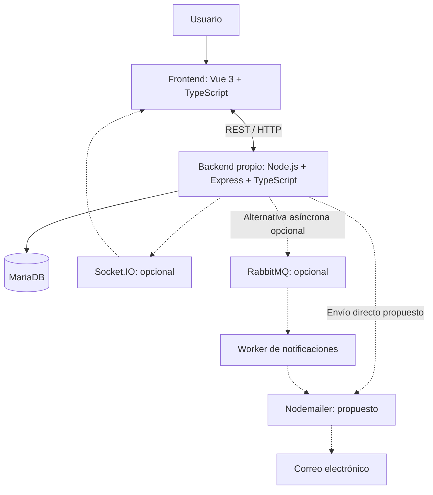

# Arquitectura general del MVP

> **Estado:** arquitectura vigente del MVP. Backend propio con Node.js + Express + TypeScript, MariaDB y API REST definidos; los detalles pendientes se enumeran en la sección 28. Esta documentación describe el diseño previsto, no funcionalidades ya implementadas.
>
> **Historial:** los entregables del Sprint 1 se conservan como evidencia histórica. Este archivo, el MER y el README reflejan las decisiones actuales y prevalecen ante diferencias con propuestas anteriores.

## 1. Objetivo

El objetivo de este documento es definir la arquitectura general prevista para el MVP de Ferrepatagonia Industrial.

La arquitectura establece cómo se dividirán las principales responsabilidades del sistema y cómo se comunicarán sus componentes:

- frontend;
- backend;
- base de datos;
- autenticación y autorización;
- manejo de archivos;
- comunicación en tiempo real.

La arquitectura se implementará con Vue 3 + TypeScript en el frontend y un backend propio Node.js + Express + TypeScript conectado a MariaDB mediante una API REST. Medusa queda descartado: el backend propio gestionará catálogo, pedidos, pagos y administración.

El backend también se utilizará como trabajo final de la materia de Backend. Los detalles de implementación todavía abiertos no vuelven provisionales las tecnologías ya adoptadas.

---

## 2. Organización del trabajo del equipo

El proyecto es desarrollado de manera colaborativa por el equipo WebFaster.

Aunque los integrantes puedan tener mayor participación o afinidad con determinadas áreas, no se establecen responsabilidades técnicas exclusivas para frontend, backend, UX/UI u otras partes del sistema.

Cualquier integrante podrá:

- desarrollar funcionalidades de frontend;
- desarrollar funcionalidades de backend;
- trabajar sobre la base de datos;
- revisar código;
- documentar decisiones técnicas;
- colaborar en UX/UI;
- participar de pruebas;
- revisar Pull Requests.

La asignación de tareas se realizará según las necesidades del proyecto, disponibilidad y conocimiento de cada integrante.

Esto permite evitar dependencias innecesarias entre miembros del equipo y facilita que las tareas puedan continuar aunque una persona determinada no se encuentre disponible.

---

## 3. Enfoque general de arquitectura

Se utilizará una arquitectura web cliente-servidor dividida principalmente en tres capas:

1. frontend;
2. backend;
3. base de datos.

La comunicación principal entre frontend y backend se realizará mediante una API REST.

Socket.IO será un complemento opcional para eventos en tiempo real. Nodemailer está propuesto para notificaciones por correo; RabbitMQ es opcional para desacoplar tareas asíncronas. Ninguno reemplaza la API REST ni constituye un requisito para ejecutar las operaciones principales.

La estructura general puede representarse de la siguiente manera:

```text
Usuario
   ↓
Frontend: Vue 3 + TypeScript
   ↓
API REST / HTTP
   ↓
Backend propio: Node.js + Express + TypeScript
   ↓
MariaDB
```

Opcionalmente, para determinados eventos en tiempo real:

```text
Backend
   ↓↑
Socket.IO
   ↓↑
Frontend
```

---

## 4. Principios de la arquitectura

La arquitectura busca respetar los siguientes principios:

- separación clara de responsabilidades;
- mantener la lógica de negocio principal en el backend;
- evitar acceso directo del frontend a la base de datos;
- utilizar una API como punto de comunicación;
- mantener módulos funcionales claros;
- reducir dependencias innecesarias entre componentes;
- facilitar el trabajo colaborativo;
- permitir que frontend y backend puedan evolucionar de manera independiente;
- evitar complejidad que no aporte valor al MVP;
- permitir ampliaciones futuras del sistema.

---

## 5. Frontend

El frontend será responsable de toda la interacción directa con el usuario.

Su función principal será mostrar información, recibir acciones del usuario y comunicarse con los servicios proporcionados por el backend.

### 5.1 Responsabilidades principales

El frontend será responsable de:

- representar la interfaz visual;
- administrar la navegación;
- mostrar productos;
- mostrar categorías;
- visualizar información de cada producto;
- administrar visualmente el carrito;
- mostrar formularios;
- permitir inicio de sesión;
- mostrar información del cliente;
- mostrar pedidos;
- mostrar información de cuenta corriente;
- mostrar pagos y comprobantes;
- mostrar el panel administrativo;
- mantener determinados estados compartidos;
- consumir la API del backend;
- recibir eventos en tiempo real si se incorpora Socket.IO;
- mostrar errores;
- mostrar confirmaciones;
- responder visualmente a cambios producidos en el sistema.

Vue Router administrará rutas y guardas de navegación para mejorar la experiencia de uso. Ocultar botones o impedir una navegación no autoriza ni protege por sí mismo una operación: el backend verificará cada solicitud.

### 5.2 Áreas principales del frontend

#### Sitio público

Incluye:

- inicio;
- catálogo;
- detalle de producto;
- carrito;
- login;
- registro;
- ayuda;
- preguntas frecuentes;
- contacto;
- información institucional.

#### Área de cliente

Incluye funcionalidades relacionadas con:

- información personal;
- pedidos;
- historial de compras;
- estado de operaciones;
- datos de cuenta.

#### Área de cliente empresa

Podrá incluir:

- pedidos;
- cuenta corriente;
- pagos;
- comprobantes;
- datos de la empresa;
- estado de aprobación administrativa.

Comprar como empresa requiere aprobación administrativa. La cuenta corriente se mostrará y podrá utilizarse únicamente si está habilitada y se cumplen las reglas comerciales.

#### Área administrativa

Permitirá administrar:

- productos;
- categorías;
- precios;
- stock;
- clientes y solicitudes de aprobación empresarial;
- pedidos;
- pagos;
- cuentas corrientes;
- configuraciones generales.

---

## 6. Estado del frontend

No toda la información obtenida desde el backend deberá almacenarse globalmente.

Se utilizará estado global solamente para información que realmente necesite ser compartida entre distintas vistas o componentes.

Ejemplos:

- usuario autenticado;
- estado de sesión;
- carrito;
- información general necesaria en múltiples vistas.

El resto de los datos podrá mantenerse localmente dentro de cada vista o componente.

Pinia administrará este tipo de estados compartidos, sin convertirse en la fuente de autoridad para permisos o condiciones comerciales.

Pinia no reemplazará la comunicación con el backend ni a Socket.IO.

---

## 7. Backend

El backend propio utilizará Node.js + Express + TypeScript y concentrará la lógica principal del sistema.

Será responsable de recibir las solicitudes realizadas por el frontend, validar la información, aplicar las reglas del negocio y acceder a la base de datos.

El backend será el único componente de la aplicación autorizado para acceder directamente a los datos persistentes.

### 7.1 Responsabilidades principales

El backend deberá:

- recibir solicitudes HTTP;
- validar información recibida;
- autenticar usuarios;
- controlar autorizaciones;
- aplicar reglas de negocio;
- consultar la base de datos;
- modificar información;
- gestionar productos;
- gestionar categorías;
- gestionar clientes;
- gestionar pedidos;
- gestionar cuentas corrientes;
- registrar pagos;
- gestionar archivos;
- gestionar la aprobación administrativa de cuentas empresa;
- validar CAPTCHA y aplicar rate limiting;
- enviar notificaciones si se adopta Nodemailer;
- emitir eventos en tiempo real si se incorpora Socket.IO;
- controlar errores;
- construir respuestas para el frontend.

---

## 8. Organización modular del backend

Se propone organizar el backend según funcionalidades del negocio.

La estructura conceptual inicial será:

```text
Backend
├── Auth
├── Usuarios
├── Clientes y aprobación empresarial
├── Productos
├── Categorías
├── Pedidos
├── Cuentas Corrientes
├── Pagos
├── Archivos
├── Notificaciones (Nodemailer propuesto)
├── Tareas asíncronas (RabbitMQ opcional)
└── Tiempo Real (Socket.IO opcional)
```

Esta división representa responsabilidades funcionales.

Express es el framework adoptado. La estructura exacta de carpetas y la implementación interna de los módulos se decidirán durante el desarrollo.

---

## 9. Autenticación

Se utilizará JWT y un único login en `/login` para clientes y administradores. Todo inicio de sesión exitoso llevará al Home (`/`), sin redirección automática al panel administrativo ni a una ruta previa.

```text
/login: email + contraseña + CAPTCHA
        ↓
Backend aplica rate limiting y valida CAPTCHA y credenciales
        ↓
Backend emite JWT e informa identidad y rol
        ↓
Home (/) para CLIENTE y ADMIN
        ↓
Interfaz muestra acciones según permisos y condiciones vigentes
```

En el Home, solo el rol `ADMIN` verá el botón para entrar al panel administrativo (`/admin`). Los clientes verán sus opciones de cuenta y pedidos; la opción de cuenta corriente dependerá de su habilitación comercial.

Se aplicará CAPTCHA al iniciar sesión y ante actividad sospechosa, junto con rate limiting validado en backend. Los umbrales y el proveedor quedan pendientes; ejemplos como «10 consultas en un segundo» no fijan una regla definitiva. Resolver un CAPTCHA no sustituye la autenticación ni la autorización.

JWT está definido. El almacenamiento/transporte del token, su expiración, renovación y cierre de sesión quedan por concretar. `localStorage` pertenece al planteo previo y no se establece aquí como estrategia definitiva; si se adoptan cookies HttpOnly, deberán definirse Secure, SameSite, CORS y protección CSRF según el despliegue. Pinia mantiene el estado visual de sesión.

La experiencia de una empresa pendiente de aprobación sigue por definir; si se permite su login, también llegará al Home y no podrá comprar hasta estar aprobada.

---

## 10. Autorización

Autenticación y autorización representan responsabilidades diferentes.

La autenticación determina:

**¿Quién es el usuario?**

La autorización determina:

**¿Qué operaciones puede realizar?**

Flujo:

```text
Usuario autenticado
        ↓
Backend identifica permisos
        ↓
¿Puede ejecutar la operación?
        ↓
Sí → continúa
No → acceso rechazado
```

Los únicos roles técnicos serán `CLIENTE` y `ADMIN`. `PARTICULAR` y `EMPRESA` son tipos de cliente; aprobación empresarial, cuenta corriente y condición de cliente fiel son condiciones comerciales independientes, no roles.

Vue Router solo controla navegación y UX. El backend validará JWT, estado del usuario, rol, pertenencia del recurso y reglas comerciales en cada operación protegida, aunque la solicitud no provenga del frontend. Para operaciones administrativas exigirá `ADMIN`.

- Sin autenticación válida: `401 Unauthorized`.
- Usuario autenticado sin permiso: `403 Forbidden`.

Ocultar el panel o su botón no reemplaza estas comprobaciones.

---

## 11. Módulo de clientes

El módulo de clientes será responsable de operaciones como:

- registrar clientes;
- consultar clientes;
- modificar información;
- identificar tipo de cliente;
- registrar solicitudes empresariales pendientes y permitir su aprobación o rechazo solo a administración;
- administrar condición de cliente fiel;
- relacionar clientes con pedidos;
- relacionar clientes habilitados con cuenta corriente;
- activar o desactivar clientes cuando corresponda.

Una cuenta empresa nace pendiente de aprobación. Solo administración puede aprobarla o rechazarla; el backend impedirá confirmar compras mientras no esté aprobada. `activo` no sustituye ese estado.

La aprobación permite comprar con las modalidades convencionales habilitadas, pero no otorga cuenta corriente ni condición de cliente fiel. Estas condiciones se administrarán por separado y tampoco sustituirán la aprobación.

---

## 12. Módulo de productos

El módulo de productos será responsable de:

- registrar productos;
- consultar productos;
- modificar información;
- administrar precios;
- administrar stock actual;
- administrar imágenes;
- activar o desactivar productos;
- relacionar productos con categorías.

---

## 13. Módulo de categorías

Permitirá:

- crear categorías;
- modificar categorías;
- consultar categorías;
- activar o desactivar categorías;
- organizar productos.

---

## 14. Módulo de pedidos

El módulo de pedidos será responsable del ciclo principal de compra.

Entre sus responsabilidades se encuentran:

- crear pedidos;
- registrar productos incluidos;
- registrar cantidades;
- conservar precios utilizados;
- aplicar descuentos;
- calcular subtotales;
- calcular totales;
- administrar estados;
- consultar pedidos.

La información histórica deberá mantenerse aunque posteriormente cambie el precio actual de un producto.

---

## 15. Cuenta corriente

El sistema deberá contemplar clientes empresariales habilitados para trabajar mediante cuenta corriente. Aprobar una empresa no habilita crédito automáticamente: la cuenta corriente requiere una habilitación comercial independiente. Para comprar a crédito, el backend comprobará tanto la aprobación de la empresa como la habilitación y las reglas de su cuenta.

El módulo correspondiente podrá encargarse de:

- consultar la cuenta;
- habilitar o deshabilitar su utilización;
- consultar operaciones;
- consultar pagos realizados;
- mantener información necesaria para representar el estado de la cuenta.

Las reglas comerciales específicas continuarán sujetas a validación con el cliente.

---

## 16. Pagos

El módulo de pagos permitirá:

- registrar pagos;
- registrar fecha;
- registrar monto;
- indicar método de pago;
- almacenar referencia del comprobante;
- consultar pagos;
- administrar estados;
- relacionar pagos con cuenta corriente cuando corresponda.

---

## 17. Manejo de archivos

El sistema deberá contemplar inicialmente archivos relacionados con:

- imágenes de productos;
- comprobantes de pago.

El frontend enviará los archivos al backend.

El backend deberá:

- recibirlos;
- validar su formato;
- validar su tamaño;
- determinar su almacenamiento;
- guardar una referencia persistente.

La estrategia definitiva de almacenamiento todavía no se encuentra definida.

---

## 18. Base de datos

El sistema utilizará MariaDB como base de datos relacional. La herramienta de acceso a datos permanece pendiente de elección.

El frontend nunca deberá acceder directamente a ella.

Toda operación deberá realizarse mediante el backend.

El modelo actual contempla las siguientes entidades principales:

- Cliente;
- Producto;
- Categoria;
- Pedido;
- DetallePedido;
- CuentaCorriente;
- Pago;
- Usuario.

El modelo completo se encuentra documentado mediante el MER del proyecto.

[Ver MER de Ferrepatagonia Industrial](../modelo-datos/mer-ferrepatagonia.md)

---

## 19. Flujo general de consulta

Ejemplo: consulta del catálogo.

```text
Usuario abre catálogo
        ↓
Frontend solicita productos
        ↓
GET /productos
        ↓
Backend recibe solicitud
        ↓
Backend consulta datos
        ↓
Base de datos devuelve productos
        ↓
Backend construye respuesta
        ↓
Frontend recibe información
        ↓
Frontend muestra catálogo
```

---

## 20. Flujo de creación de pedido

Un flujo conceptual podría ser:

```text
Usuario confirma carrito
        ↓
Frontend envía pedido
        ↓
POST /pedidos
        ↓
Backend valida autenticación, rol CLIENTE y cliente asociado
        ↓
Backend verifica aprobación administrativa si es EMPRESA
        ↓
Backend valida productos
        ↓
Backend valida cantidades
        ↓
Backend aplica reglas comerciales
        ↓
Backend registra Pedido
        ↓
Backend registra DetallePedido
        ↓
Base de datos
        ↓
Backend responde
        ↓
Frontend muestra resultado
```

---

## 21. API REST

REST será el mecanismo principal de comunicación para ejecutar operaciones del sistema.

Ejemplos conceptuales:

```text
GET    /productos
GET    /productos/:id
GET    /categorias

POST   /pedidos
GET    /pedidos/:id

GET    /clientes/:id

POST   /pagos

POST   /auth/login
```

Estos endpoints son solamente ejemplos.

No representan todavía el contrato definitivo de la API.

La definición detallada se realizará durante la implementación.

---

## 22. Comunicación en tiempo real

Socket.IO es opcional y complementario. Podrá informar cambios a los clientes conectados cuando el tiempo real aporte valor; el MVP debe poder operar mediante REST sin esta integración.

Posibles eventos:

- nueva solicitud empresarial;
- nuevo comprobante recibido;
- nuevo pedido;
- cambio de estado de pedido;
- actualización relevante de stock;
- pago aprobado;
- pago rechazado;
- actualización relevante del panel administrativo.

La lista definitiva será determinada durante la implementación.

---

## 23. Relación entre REST y Socket.IO

REST y Socket.IO tendrán responsabilidades diferentes.

REST realizará las operaciones principales.

Socket.IO permitirá comunicar determinados cambios después de que esas operaciones hayan sido procesadas.

Ejemplo:

```text
Frontend
   │
   │ POST /pedidos
   ▼
Backend
   │
   │ guarda pedido
   ▼
Base de datos
```

Luego:

```text
Backend
   │
   │ nuevo_pedido
   ▼
Socket.IO
   │
   ▼
Panel administrativo
```

De esta manera:

**REST ejecuta la operación.**

**Socket.IO comunica el cambio.**

---

## 24. Seguridad de las conexiones en tiempo real

Si se utiliza Socket.IO, las conexiones deberán ser autenticadas.

El backend validará JWT durante el establecimiento de la conexión y autorizará la suscripción a eventos según rol y pertenencia de los recursos.

JWT permite verificar la identidad del usuario mediante un token firmado.

La confidencialidad del transporte deberá garantizarse mediante HTTPS/WSS en producción.

Los eventos no expondrán solicitudes, pedidos ni comprobantes a usuarios sin permisos. El transporte del token se definirá junto con la estrategia de sesión.

---

## 25. Arquitectura general completa



Las líneas punteadas representan integraciones propuestas u opcionales. El envío directo y el envío mediante RabbitMQ son alternativas para una misma notificación, no dos envíos simultáneos.

Nodemailer está propuesto para avisar sobre solicitudes empresariales, aprobación o rechazo, habilitación de cuenta corriente, cambios de condición de cliente fiel y recepción o revisión de comprobantes. Estos avisos reflejan operaciones persistidas; un correo no concede permisos ni cambia estados por sí mismo.

RabbitMQ podrá desacoplar el envío mediante un worker. No es necesario incorporarlo para usar Nodemailer ni para cerrar las operaciones de negocio. Socket.IO complementa la actualización de la interfaz y tampoco reemplaza REST. Medusa queda descartado.

---

## 26. Estilo arquitectónico del backend

Para el alcance actual del MVP se utilizará un único backend propio organizado internamente mediante módulos funcionales.

No se plantea utilizar una arquitectura de microservicios.

La utilización de un único backend permite:

- reducir complejidad;
- simplificar desarrollo;
- simplificar despliegue;
- facilitar pruebas;
- facilitar depuración;
- mantener una separación lógica entre funcionalidades.

La arquitectura podrá evolucionar posteriormente si las necesidades reales del sistema lo requieren.

---

## 27. Seguridad general

La arquitectura deberá contemplar como mínimo:

- HTTPS en producción;
- autenticación mediante JWT;
- CAPTCHA en login y ante actividad sospechosa, validado en backend;
- rate limiting en autenticación y endpoints sensibles;
- autorización y comprobación de propiedad en backend;
- validación de información recibida;
- hash seguro de contraseñas;
- protección de endpoints;
- validación de archivos;
- manejo controlado de errores;
- protección de conexiones Socket.IO si se incorporan;
- control de acceso a operaciones administrativas.

Las implementaciones específicas serán definidas posteriormente.

---

## 28. Decisiones todavía abiertas

Node.js, Express, TypeScript, MariaDB, REST y JWT están definidos. Medusa está descartado. Permanece pendiente concretar:

- herramienta de acceso a datos y migraciones;
- estrategia de almacenamiento de archivos;
- transporte, almacenamiento, expiración, renovación y cierre de sesión de JWT;
- proveedor y política de CAPTCHA, umbrales y ventanas de rate limiting;
- experiencia de acceso y visualización del estado para empresas pendientes o rechazadas, manteniendo bloqueada la compra;
- adopción de Nodemailer y configuración del servicio de correo;
- incorporación y eventos de Socket.IO, opcional;
- incorporación de RabbitMQ, opcional, y política de reintentos de notificaciones;
- detalles de validación, documentación de API y requisitos adicionales de la materia;
- reglas específicas de crédito, descuentos e imputación de pagos.

Estas decisiones precisarán la implementación sin reabrir el stack ya adoptado.

---

## 29. Relación con el stack tecnológico

Este documento define principalmente **cómo se organiza el sistema**.

El documento de stack tecnológico define principalmente **con qué herramientas se implementará**.

Por ejemplo:

```text
Arquitectura:
Frontend → Backend → Base de datos
```

El stack vigente establece:

```text
Vue 3 + TypeScript → REST → Node.js + Express + TypeScript → MariaDB
```

La propuesta inicial de stack conservada en el repositorio corresponde a una etapa anterior. Ante diferencias, las decisiones vigentes se consultan en este documento y en el README; los entregables del Sprint 1 mantienen su valor histórico.

---

## 30. Trabajo colaborativo

La arquitectura propuesta no establece que una persona determinada sea responsable exclusivamente de una capa.

El equipo podrá distribuir las tareas según el momento del proyecto.

Un integrante podrá, por ejemplo:

- implementar una funcionalidad backend;
- trabajar luego sobre una vista frontend;
- revisar una consulta SQL;
- corregir documentación;
- participar de pruebas;
- revisar un Pull Request de otro integrante.

Las asignaciones de Taiga representan responsables de tareas específicas y no roles técnicos permanentes dentro del equipo.