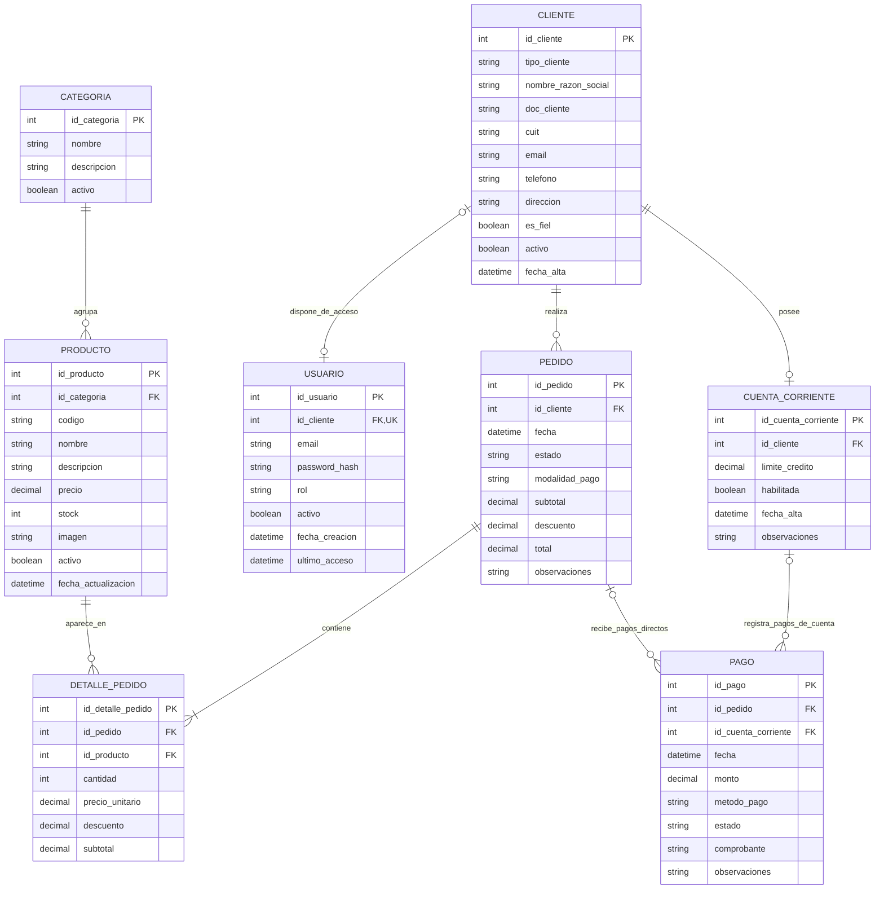

# Ferrepatagonia Industrial — Modelo entidad-relación

> Propuesta de actualización de la tarea #98, basada en el MER previo y en las definiciones de acceso del MVP. Mantener el historial y las secciones adicionales del archivo original del repositorio si existieran.

## Reglas y alcance de la actualización

**Identidad y roles (definición de la historia #68)**

- `USUARIO.rol` admite `CLIENTE` o `ADMIN`. El visitante no necesita registro en `USUARIO`.
- `CLIENTE.tipo_cliente` admite `PARTICULAR` o `EMPRESA`. Es una característica comercial, no un rol de autenticación.
- Si `USUARIO.rol = CLIENTE`, `USUARIO.id_cliente` es obligatorio y referencia un único `CLIENTE`.
- Si `USUARIO.rol = ADMIN`, `USUARIO.id_cliente` es nulo; no se crea una entidad `ADMINISTRADOR` para el MVP.
- `USUARIO.id_cliente` es único cuando no es nulo, de modo que cada `CLIENTE` tiene cero o una cuenta de acceso. La notación del diagrama expresa la opcionalidad general; las reglas condicionales por rol deben implementarse como restricciones y/o validaciones de backend.
- La cuenta corriente y la condición de cliente fiel no son roles. El acceso a operaciones de crédito requiere comprobar habilitación, propiedad y reglas comerciales vigentes.

**Pagos y comprobantes (ajuste propuesto para representar compras convencionales)**

- `PAGO.id_pedido` referencia un pedido cuando el pago corresponde a una compra convencional, sea de un cliente particular o de una empresa.
- `PAGO.id_cuenta_corriente` referencia una cuenta corriente cuando el pago corresponde a un abono de esa cuenta.
- En el diseño inicial, **exactamente uno** entre `id_pedido` e `id_cuenta_corriente` tiene un valor por pago; ambos campos son individualmente anulables. El diagrama ER, por sí solo, no representa esta exclusividad: debe aplicarse con una restricción `CHECK` o validación transaccional.
- Para un pago directo, el cliente autorizado se obtiene a partir de `PEDIDO.id_cliente`; para un abono de cuenta corriente, de `CUENTA_CORRIENTE.id_cliente`. En ambos casos, el backend comprueba la pertenencia antes de aceptar o mostrar comprobantes.
- Subir un comprobante no implica que el pago esté validado: su estado se administra según el flujo de pagos.
- **Supuesto de alcance por confirmar:** un pago de cuenta corriente se registra contra la cuenta, no se distribuye automáticamente entre múltiples pedidos. Si se necesita imputar un único abono a varias facturas/pedidos, hará falta modelar esa imputación por separado.

**Nota de implementación:** verificar la sintaxis de tipos y claves con el motor de base de datos finalmente elegido. Mermaid es un modelo conceptual: la nulabilidad condicional, `UNIQUE`, `CHECK`, claves foráneas, dominios de valores y políticas de borrado se definirán en el esquema/migraciones SQL.
