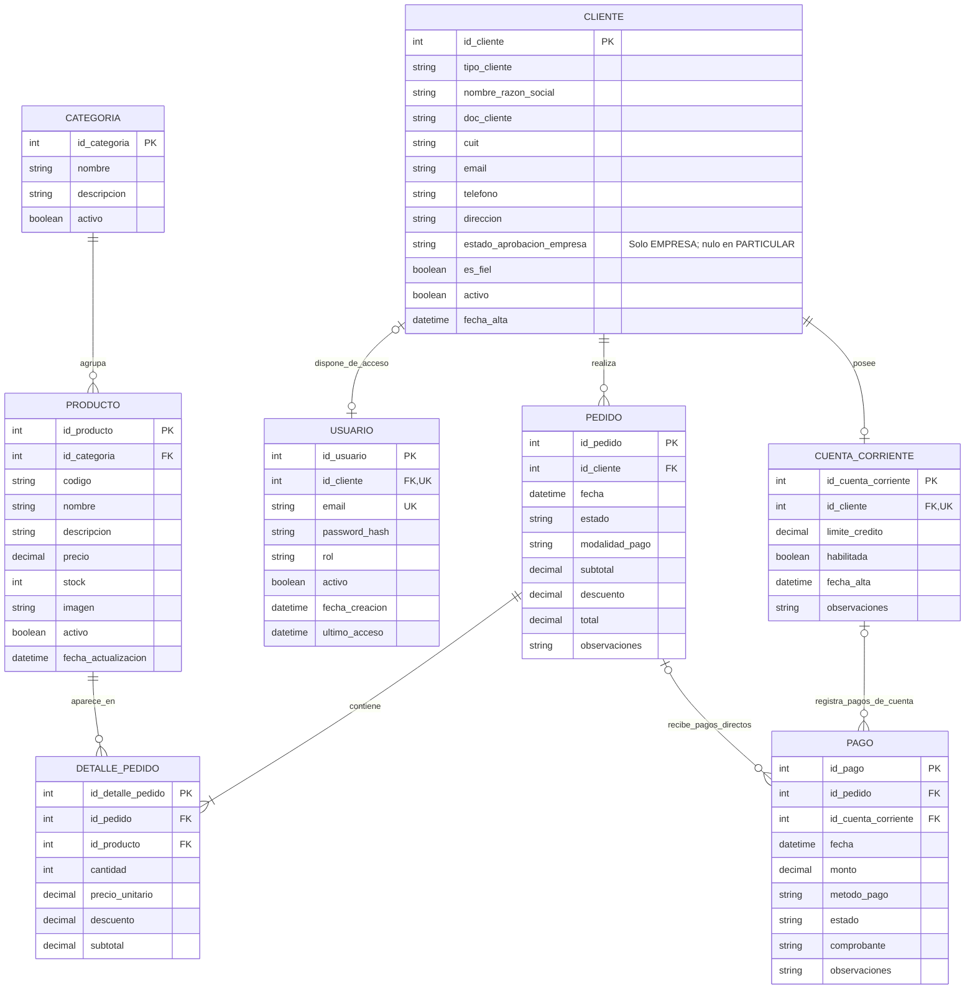

# Ferrepatagonia Industrial — Modelo entidad-relación

> **Estado:** modelo conceptual vigente del MVP para MariaDB, actualizado a partir del MER previo de la tarea #98 y de las definiciones de identidad de la historia #68. No implica que el esquema SQL ya esté implementado. Los entregables del Sprint 1 se conservan como documentación histórica.

## Reglas y alcance de la actualización

**Identidad y roles (base de la historia #68 y decisiones vigentes)**

- `USUARIO.rol` admite `CLIENTE` o `ADMIN`. El visitante no necesita registro en `USUARIO`.
- `CLIENTE.tipo_cliente` admite `PARTICULAR` o `EMPRESA`. Es una característica comercial, no un rol de autenticación.
- Si `USUARIO.rol = CLIENTE`, `USUARIO.id_cliente` es obligatorio y referencia un único `CLIENTE`.
- Si `USUARIO.rol = ADMIN`, `USUARIO.id_cliente` es nulo; no se crea una entidad `ADMINISTRADOR` para el MVP.
- `USUARIO.id_cliente` es único cuando no es nulo, de modo que cada `CLIENTE` tiene cero o una cuenta de acceso. La notación del diagrama expresa la opcionalidad general; las reglas condicionales por rol deben implementarse como restricciones y/o validaciones de backend.
- `USUARIO.email` es único: un mismo formulario de login identifica tanto a clientes como a administradores. `CLIENTE.email` es un dato de contacto comercial y no crea una segunda identidad de acceso.
- Todos los inicios de sesión exitosos llevan al Home (`/`). Solo `ADMIN` ve allí el acceso al panel administrativo.
- JWT identifica la sesión; CAPTCHA y rate limiting protegen el acceso y la actividad sospechosa. Vue Router administra navegación y UX; el backend comprueba autenticación, rol, propiedad y reglas comerciales.
- La cuenta corriente y la condición de cliente fiel no son roles. El acceso a operaciones de crédito requiere comprobar aprobación empresarial, habilitación, propiedad y reglas comerciales vigentes.

**Aprobación empresarial y condiciones comerciales independientes**

- Para `EMPRESA`, `CLIENTE.estado_aprobacion_empresa` es obligatorio y admite `PENDIENTE`, `APROBADA` o `RECHAZADA`. Una nueva solicitud empresarial comienza en `PENDIENTE`; únicamente `ADMIN` puede aprobarla o rechazarla. El cliente no puede elegir ni modificar ese estado en su registro.
- Para `PARTICULAR`, `estado_aprobacion_empresa` es nulo: la aprobación empresarial no se aplica.
- El backend impide confirmar pedidos de una empresa cuyo estado no sea `APROBADA`, incluso si tiene cuenta corriente habilitada o `es_fiel = true`. Esta regla se comprueba al operar, no solo al iniciar sesión.
- `CLIENTE.activo` y `USUARIO.activo` conservan sus funciones de habilitación general y de acceso, respectivamente; ninguno reemplaza la aprobación empresarial.
- Aprobar la empresa permite comprar con las modalidades convencionales habilitadas. No crea ni habilita automáticamente una cuenta corriente, ni modifica `es_fiel`.
- `CUENTA_CORRIENTE` es opcional, corresponde a un cliente de tipo `EMPRESA` y `id_cliente` es único, consistente con la cardinalidad cero o una cuenta por cliente. `habilitada` determina su habilitación comercial; la mera existencia de la cuenta no concede crédito.
- `CLIENTE.es_fiel` es una condición comercial administrada por Ferrepatagonia, independiente del tipo de cliente, de la aprobación empresarial y de la cuenta corriente. No concede acceso administrativo ni autoriza compras empresariales sin aprobación.
- La UX de empresas pendientes o rechazadas queda por definir. Si se permite iniciar sesión, el destino será el Home y la compra seguirá bloqueada.
- Nodemailer está propuesto para notificar solicitudes y resoluciones; Socket.IO y RabbitMQ son complementos opcionales y no modifican estas reglas del modelo.

**Pagos y comprobantes (ajuste propuesto para representar compras convencionales)**

- `PAGO.id_pedido` referencia un pedido cuando el pago corresponde a una compra convencional, sea de un cliente particular o de una empresa.
- `PAGO.id_cuenta_corriente` referencia una cuenta corriente cuando el pago corresponde a un abono de esa cuenta.
- En el diseño inicial, **exactamente uno** entre `id_pedido` e `id_cuenta_corriente` tiene un valor por pago; ambos campos son individualmente anulables. El diagrama ER, por sí solo, no representa esta exclusividad: debe aplicarse con una restricción `CHECK` o validación transaccional.
- Para un pago directo, el cliente autorizado se obtiene a partir de `PEDIDO.id_cliente`; para un abono de cuenta corriente, de `CUENTA_CORRIENTE.id_cliente`. En ambos casos, el backend comprueba la pertenencia antes de aceptar o mostrar comprobantes.
- Subir un comprobante no implica que el pago esté validado: su estado se administra según el flujo de pagos.
- **Supuesto de alcance por confirmar:** un pago de cuenta corriente se registra contra la cuenta, no se distribuye automáticamente entre múltiples pedidos. Si se necesita imputar un único abono a varias facturas/pedidos, hará falta modelar esa imputación por separado.

**Nota de implementación:** el motor adoptado es MariaDB y el backend propio será Node.js + Express + TypeScript, expuesto mediante REST; Medusa está descartado. Mermaid es un modelo conceptual: los tipos físicos, la nulabilidad condicional, `UNIQUE`, `CHECK`, claves foráneas, dominios de valores y políticas de borrado se precisarán en el esquema y las migraciones. La herramienta de acceso a datos sigue pendiente. Las reglas que involucren rol, aprobación o varias entidades también deberán validarse en backend dentro de la operación correspondiente.

[Consultar la arquitectura vigente](../arquitectura/arquitectura-general.md) · [Volver al README](../../README.md)
