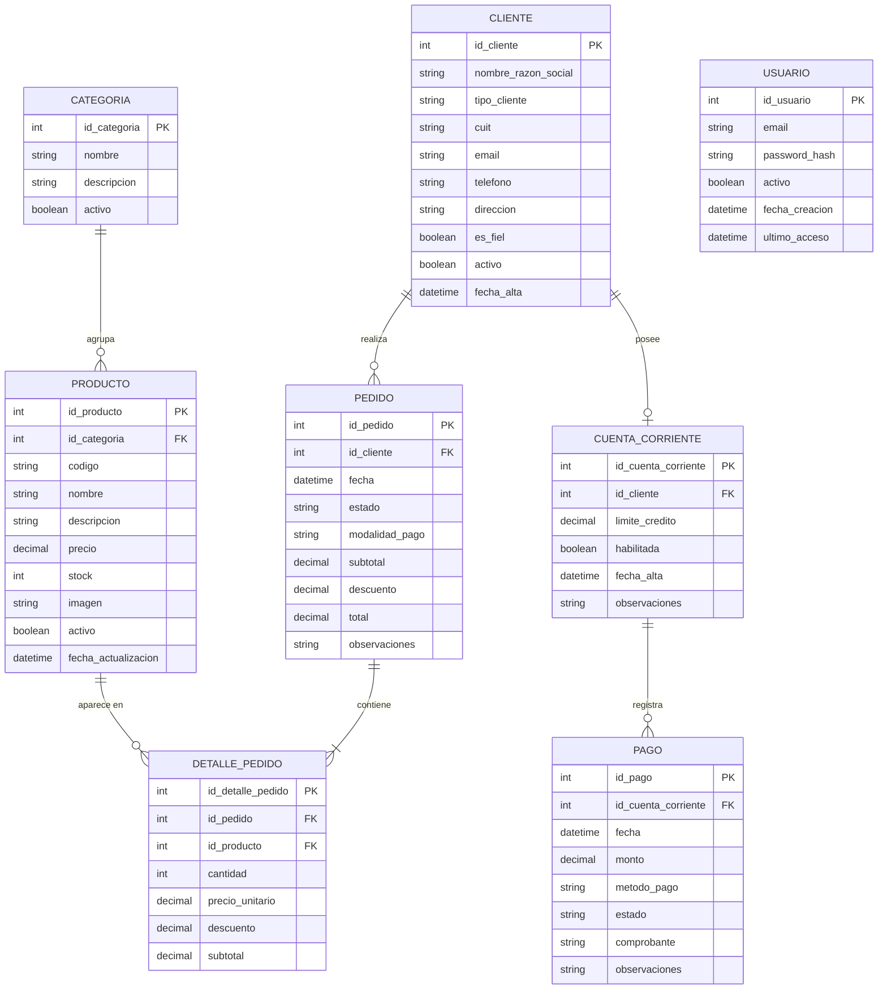

# Modelo Entidad-Relación — Ferrepatagonia Industrial

Este documento contiene la representación actual del modelo de datos del MVP de Ferrepatagonia Industrial.

El modelo fue construido a partir del relevamiento, las reglas del negocio y las definiciones realizadas durante el Sprint 1.

La representación utiliza Mermaid para mantener el modelo versionado junto con el código fuente del proyecto.

> Las definiciones relacionadas con usuarios, roles y autenticación podrán actualizarse durante la historia correspondiente.

## MER

## Decisiones del MVP

- Un cliente puede realizar múltiples pedidos.
- Un pedido confirmado contiene uno o más detalles.
- `DETALLE_PEDIDO` resuelve la relación entre pedidos y productos y conserva los valores utilizados al momento de la operación.
- Un cliente puede no poseer cuenta corriente o poseer una única cuenta.
- Para el MVP cada producto pertenece a una categoría.
- Una cuenta corriente puede registrar múltiples pagos.
- El stock se mantiene como atributo de `PRODUCTO`.
- La condición de cliente fiel se representa mediante `CLIENTE.es_fiel`.
- El comprobante de pago se mantiene como referencia dentro de `PAGO`.
- La cotización del dólar se considera una configuración del sistema y no una entidad independiente.

## Decisiones pendientes

La entidad `USUARIO` se mantiene sin una relación definitiva dentro del MER hasta completar la definición de roles y autenticación.

Durante esa historia se deberá establecer:

- relación entre Usuario y Cliente;
- representación de usuarios administrativos;
- roles existentes;
- permisos asociados a cada rol.

El modelo podrá actualizarse posteriormente a partir de estas definiciones.